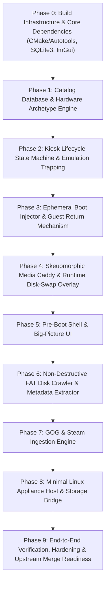

# DOSBox-X Kiosk Launcher: High-Level Implementation Plan

**Target System:** DOSBox-X Kiosk Fork  
**Reference Document:** [`docs/Kiosk/DOSBox-X Kiosk Launcher Design.md`](file:///C:/code/dosbox-x-kiosk/docs/Kiosk/DOSBox-X%20Kiosk%20Launcher%20Design.md)  
**Document Status:** High-Level Architectural Implementation Plan (Draft for Review)  
**Creation Date:** October 28, 2026  

---

## 1. Executive Summary & Architectural Vision

The **DOSBox-X Kiosk Edition** project transforms standard DOSBox-X into a dedicated, appliance-grade retro computing console. Instead of wrapping DOSBox-X in an external frontend (such as LaunchBox, Pegasus, or EmulationStation) which forfeits control once a guest OS boots raw disk images (`BOOT` / `IMGMOUNT`), this project embeds:
1. An **In-Process Pre-Boot Kiosk Shell** with a 30-second watchdog countdown, Big-Picture Carousels, and Machine Creation Wizard.
2. A **Skeuomorphic Runtime Overlay (F12+D)** for visual, non-breaking floppy and CD-ROM swapping directly hooked into DOSBox-X's Floppy Controller (`0x3F7`) and ATAPI CD-ROM emulation.
3. A **Non-Destructive Ephemeral Boot Injector** using a RAM-backed secondary dispatch disk (`D:`) and an embedded 48-byte shutdown binary (`KIOSKEXT.COM`) to launch software directly inside real MS-DOS / Windows 9x machines and return cleanly to the shell upon exit.
4. An **In-Process FAT12/16/32 Crawler & GOG/Steam Ingestion Engine** to index installed software and convert commercial digital game releases into standardized Kiosk Archetypes.
5. A **Minimal Linux Appliance Host** with KMSDRM rendering, systemd watchdog supervision, read-only OverlayFS, and udisks2 DBus auto-mounting.

To maintain upstream maintainability with `joncampbell123/dosbox-x`, all new code will reside in a dedicated directory (`src/kiosk/`) protected behind a build-time toggle (`ENABLE_KIOSK`) and runtime command-line switch (`--kiosk-mode`).

---

## 2. Architectural Blueprint & Component Map

```
+-----------------------------------------------------------------------------------+
|                        MINIMAL LINUX APPLIANCE HOST                               |
|  [systemd auto-login] ---> [SDL2 KMSDRM / libseat] ---> [udisks2 DBus Monitor]    |
+-----------------------------------------------------------------------------------+
                                         |
                                         v
+-----------------------------------------------------------------------------------+
|                           DOSBOX-X KIOSK FORK BINARY                              |
|                                                                                   |
|  +-----------------------------------+     +-----------------------------------+  |
|  |     STAGE 1: PRE-BOOT SHELL       |     |    STAGE 2: EMULATION RUNTIME     |  |
|  |  - 30s Countdown Watchdog         |     |  - Guest OS Execution (Real/PM)   |  |
|  |  - Games / Apps Carousels         | ==> |  - In-Memory Config Synthesis     |  |
|  |  - Hardware Archetype Wizard      |     |  - Ephemeral Dispatch Drive (D:)  |  |
|  |  - OS Installer & Ingest Engine   |     |  - Caught APM / Port 0x8900 Exit  |  |
|  +-----------------------------------+     +-----------------------------------+  |
|                    ^                                         |                    |
|                    | (Clean Return on Guest Power-Off)       | (Hotkey: F12+D)    |
|                    |                                         v                    |
|                    |                       +-----------------------------------+  |
|                    +-----------------------|   STAGE 3: SKEUOMORPHIC OVERLAY   |  |
|                                            |  - Pauses CPU_Cycles & Audio DMA  |  |
|                                            |  - 5.25" / 3.5" / CD-ROM Caddy    |  |
|                                            |  - FDC 0x3F7 & ATAPI Sense Swap   |  |
|                                            +-----------------------------------+  |
+-----------------------------------------------------------------------------------+
```

### Module Distribution & Source Hierarchy

```
src/
├── kiosk/                               # Isolated Kiosk Subsystem
│   ├── kiosk_main.h / .cpp              # 6-state lifecycle machine & watchdog
│   ├── kiosk_db.h / .cpp                # SQLite3 WAL data access layer
│   ├── kiosk_types.h                    # Core data structures & enum definitions
│   │
│   ├── machine/                         # Virtual Machine & Execution Synthesis
│   │   ├── archetypes.h / .cpp          # 5 Hardware Archetypes (XT -> Pentium 3dfx)
│   │   ├── config_synthesizer.h / .cpp  # Multi-layer in-memory DOSBox-X .conf synthesis
│   │   ├── boot_injector.h / .cpp       # Ephemeral RAM disk (D:) & AUTOEXEC / SYSTEM.INI hooks
│   │   └── kioskext_bin.h               # 48-byte compiled KIOSKEXT.COM payload
│   │
│   ├── ui/                              # Unified Rendering & Input
│   │   ├── kiosk_ui.h / .cpp            # ImGui / OpenGL compositing engine
│   │   ├── input_router.h / .cpp        # Keyboard / Gamepad / Mouse unified mapper
│   │   ├── view_watchdog.h / .cpp       # 30-second non-blocking countdown banner
│   │   ├── view_carousel.h / .cpp       # Cover-flow Games & Applications carousels
│   │   ├── view_wizard.h / .cpp         # 4-step Hardware & OS Provisioning wizard
│   │   ├── view_disk_caddy.h / .cpp     # Skeuomorphic 5.25", 3.5", CD jewel case renderer
│   │   └── runtime_overlay.h / .cpp     # In-process F12+D emulation pause & disk swapper
│   │
│   └── ingest/                          # Crawler, Ingestion & Host Bridge
│       ├── image_crawler.h / .cpp       # Userspace FAT12/16/32 RO-VFS, .GRP/.LNK, & NE/PE parser
│       ├── signature_matcher.h / .cpp   # Extender-stub-stripping LE/LX CRC32 fingerprinter
│       ├── archive_importer.h / .cpp    # GOG (innoextract) & Steam (.zip) pipeline
│       ├── conf_translator.h / .cpp     # dosbox.conf AST parser to Kiosk Archetypes
│       └── usb_bridge.h / .cpp          # udisks2 / sd-bus hotplug listener
│
├── dosbox.cpp                           # Hook Point 1: CLI parse & kiosk loop intercept
├── gui/sdlmain.cpp                      # Hook Point 2: Input routing, GFX_EndUpdate overlay, F12+D
├── ints/bios.cpp                        # Hook Point 3: INT 15h APM & Port 0x8900 shutdown catch
└── hardware/floppy.cpp, ide.cpp         # Hook Point 4: Direct FDC & ATAPI media change signals
```

---

## 3. Phased Implementation Roadmap

To maintain agility and verify components incrementally, the implementation is decomposed into **10 structured phases**. Each phase produces a working, testable milestone.



---

### Phase 0: Build Infrastructure & Core Dependencies

**Goal:** Integrate required third-party libraries and build-time flags into DOSBox-X without disturbing standard builds.

- **0.1 Build System Flags:**
  - Introduce `ENABLE_KIOSK` preprocessor definition in `configure.ac`, `Makefile.am`, and `vs/dosbox-x.vcxproj`.
  - Default `ENABLE_KIOSK=no` on generic builds; enable explicitly via `./configure --enable-kiosk`.
- **0.2 Third-Party Library Integration:**
  - **SQLite 3.4x (Amalgamation):** Add `sqlite3.c` and `sqlite3.h` to `src/libs/sqlite3/`.
  - **Dear ImGui (Docking/Current Branch):** Add core ImGui files with SDL2 and OpenGL3 backends into `src/libs/imgui/`.
  - **Single-Header Utilities:** Integrate `stb_image_write.h` / `lodepng` for icon caching and `miniz` for in-memory zip operations.
- **0.3 Platform Compatibility:**
  - Verify compilation on Linux (GCC/Clang) and Windows (MSVC / MinGW).

---

### Phase 1: Catalog Database & Hardware Archetype Engine

**Goal:** Establish the persistent state repository and hardware configuration synthesis logic.

- **1.1 SQLite Schema & DAL (`src/kiosk/kiosk_db.cpp`):**
  - Implement WAL-mode connection manager with foreign keys enabled.
  - Implement full DDL migration script: `kiosk_config`, `media_pool`, `os_distributions`, `machines`, `catalog_items`, `caddy_bindings`, `software_signatures`.
  - Provide CRUD APIs for machine definitions, media pool entries, and caddy queues.
  - Pre-populate default `os_distributions` (DOS 1.0–6.22, FreeDOS 1.3, Windows 3.11, Windows 95 OSR2, Windows 98 SE).
- **1.2 Hardware Archetype Engine (`src/kiosk/machine/archetypes.cpp`):**
  - Define the 5 canonical hardware profiles in code:
    1. `ARCH_XT_8088`: 4.77 MHz 8088, CGA, PC Speaker/Tandy, 640KB RAM, XT-IDE.
    2. `ARCH_AT_286`: 12 MHz 286, EGA, AdLib OPL2, 2MB RAM, APM 1.0.
    3. `ARCH_386DX`: 33 MHz 386DX, Tseng ET4000 SVGA, Sound Blaster Pro 2, FluidSynth MT-32/GM, 8MB RAM.
    4. `ARCH_486DX2`: 66 MHz 486DX2, S3 Trio64, Sound Blaster 16 + Gravis Ultrasound, 16MB RAM.
    5. `ARCH_PENTIUM_3DFX`: Pentium MMX, Voodoo 3dfx, Sound Blaster 16 Vibra, 64MB RAM, FAT32/Win9x APM 1.2.
- **1.3 Layered Config Synthesizer (`src/kiosk/machine/config_synthesizer.cpp`):**
  - Synthesize configs hierarchically: `kiosk_base.conf` + Archetype Delta + User Machine Overrides + Dynamic `[autoexec]`.

---

### Phase 2: Kiosk Lifecycle State Machine & Emulation Trapping

**Goal:** Enable DOSBox-X to boot into the Kiosk lifecycle, run emulation sessions inside a trap block, and return to the Kiosk without process termination.

- **2.1 CLI Argument Parsing & Boot Intercept (`src/dosbox.cpp`):**
  - Add `--kiosk-mode`, `--kiosk-db <path>`, and `--kiosk-conf <path>` options.
  - When `--kiosk-mode` is active, bypass normal shell startup and branch into `KioskManager::GetInstance().RunMainLoop()`.
- **2.2 Lifecycle State Machine (`src/kiosk/kiosk_main.cpp`):**
  - Implement the 6 runtime states: `STATE_KIOSK_BOOT`, `STATE_COUNTDOWN_IDLE`, `STATE_SHELL_INTERACTIVE`, `STATE_SYNTHESIZE_LAUNCH`, `STATE_EMULATION_RUNNING`, `STATE_RUNTIME_OVERLAY`.
- **2.3 Emulation Session Runner & Hardware Teardown:**
  - Wrap `DOSBOX_RunMachine()` in a try/catch block for `KioskGuestShutdownException`.
  - In `src/gui/sdlmain.cpp`, update the exception handler: when `x == 0` (or `KioskGuestShutdownException`), instead of exiting the process, cleanly tear down guest disk/DMA state and transition to `STATE_SHELL_INTERACTIVE`.
  - Intercept INT 15h AX=5307h CX=0003h (APM Power Off) in `src/ints/bios.cpp` to signal Kiosk shutdown.
  - Implement I/O Port `0x8900` ("Shutdown") write-handler fallback for XT/8088 machines without APM.

---

### Phase 3: Ephemeral Boot Injector & Guest Return Mechanism

**Goal:** Launch specific games/applications inside real MS-DOS and Windows 9x machines without mutating or corrupting the guest hard disk.

- **3.1 The 48-Byte `KIOSKEXT.COM` Payload:**
  - Assemble and test `kioskext.asm`:
    - Stage 1: Commit FAT caches via INT 21h AH=0Dh.
    - Stage 2: APM 1.1/1.2 power-off via INT 15h AX=5307h.
    - Stage 3: Port 0x8900 Bochs power-off fallback.
  - Embed payload as a `constexpr` byte array in `src/kiosk/machine/kioskext_bin.h`.
- **3.2 Ephemeral RAM Dispatch Drive (`src/kiosk/machine/boot_injector.cpp`):**
  - Synthesize a 1.44MB FAT12 disk image in memory (`/run/user/1000/kiosk/dispatch.img` or Windows `%TEMP%`).
  - Populate with target-specific `KIOSKGO.BAT`, `KIOSKEXT.COM`, and `KIOSKWIN.EXE`.
  - Mount dispatch image on Primary IDE Slave (`-ide 1s`), guaranteeing deterministic assignment as drive `D:`.
- **3.3 One-Time Guest Boot Hooking:**
  - Provide helper to append `IF EXIST D:\KIOSKGO.BAT CALL D:\KIOSKGO.BAT` to guest `C:\AUTOEXEC.BAT`.
  - For Windows 3.1 / 95 / 98 targets:
    - Pre-patch `SYSTEM.INI` `[boot] shell=D:\KIOSKWIN.EXE`.
    - Provide `KIOSKWIN.EXE` (small Win32 stub) that restores `SYSTEM.INI`, spawns target application, tracks process exit, and triggers `ExitWindowsEx(EWX_SHUTDOWN | EWX_FORCE, 0)`.

---

### Phase 4: Skeuomorphic Media Caddy & Runtime Disk-Swap Overlay

**Goal:** Deliver visual floppy and CD-ROM swapping during active emulation via F12+D without breaking fullscreen DRM or crashing guest drivers.

- **4.1 Hotkey Interception & Audio-Safe Pausing (`src/gui/sdlmain.cpp`):**
  - Intercept `F12+D` (and Gamepad Guide button) in `GFX_Events()`.
  - Transition to `STATE_RUNTIME_OVERLAY`:
    - Snapshot guest framebuffer into an OpenGL texture.
    - Lock and disable audio mixer (`MIXER_LockAudioDevice()`, `MIXER_Enable(false)`).
    - Release relative mouse lock.
    - Halt CPU cycles while keeping SDL frame updates alive.
- **4.2 Procedural Media Renderer (`src/kiosk/ui/view_disk_caddy.cpp`):**
  - Render 5.25" floppy disks (charcoal shell, index hole, write-protect notch).
  - Render 3.5" microfloppies (beige, blue, black shells with metal shutter).
  - Render CD-ROM jewel cases (polycarbonate reflection, Redbook audio badge).
  - Dynamically draw volume labels extracted from BPB / ISO9660 PVD using dot-matrix or handwritten font rasterization.
- **4.3 Direct Hardware Remounting & Guest Bus Signaling:**
  - Implement `DriveManager::AppendAndSwapDisk()` for dynamic runtime disk addition.
  - **Floppy Swaps:** Toggle FDC 0x3F7 bit 7 (`DSKCHG`) and hold door open for 100ms via `PIC_AddEvent` to force guest OS FAT cache invalidation.
  - **ATAPI CD-ROM Swaps:** Trigger ATAPI Unit Attention sense condition (`ASC=0x28, NOT READY TO READY TRANSITION`) to prompt Windows 9x AutoPlay / CDFS TOC re-read.

---

### Phase 5: Pre-Boot Shell & Big-Picture UI

**Goal:** Build the complete interactive user interface rendered via OpenGL/ImGui.

- **5.1 Compositor Integration (`src/kiosk/ui/kiosk_ui.cpp`):**
  - Hook into `GFX_EndUpdate()` to composite ImGui passes over the display framebuffer.
  - Implement CRT shader / blur background for overlays.
- **5.2 Unified Input Router (`src/kiosk/ui/input_router.cpp`):**
  - Map Keyboard, Mouse, and Gamepad / Arcade Joystick into unified actions: `NAV_LEFT/RIGHT/UP/DOWN`, `ACTION_CONFIRM`, `ACTION_BACK`, `ACTION_CADDY_QUEUE`, `ACTION_VIEW_TOGGLE`.
- **5.3 30-Second Autoboot Watchdog (`src/kiosk/ui/view_watchdog.cpp`):**
  - Display animated countdown timer bar in `STATE_COUNTDOWN_IDLE`.
  - Pause on any intentional user input and transition to `STATE_SHELL_INTERACTIVE`.
  - Auto-launch default machine / last played game upon countdown expiration.
- **5.4 Carousels & Machine Builder Wizard:**
  - Games and Applications cover-flow carousels with archetype badges and context actions.
  - Machines view with period-accurate desktop/tower representations.
  - 4-step Machine Creation & OS Provisioning Wizard with tier compatibility enforcement.

---

### Phase 6: Non-Destructive FAT Disk Crawler & Metadata Extractor

**Goal:** Automatically discover, classify, and extract icons from software installed on real hard drive images (`hdd_c.img`).

- **6.1 Userspace Read-Only VFS (`src/kiosk/ingest/image_crawler.cpp`):**
  - Wrap DOSBox-X's `imageDisk` class with a strictly read-only sector stream.
  - Parse MBR partition tables (LBA start) and FAT12/16/32 BPBs.
  - Walk directory clusters with VFAT Long Filename (LFN) UTF-16LE reconstruction.
- **6.2 Multi-Era Discovery & Scoring Heuristics:**
  - Prune system trees (`\DOS`, `\WINDOWS\SYSTEM`, drivers).
  - Apply ignore blocklist against setup utilities, DOS extenders, and sound configurators.
  - Score candidates in DOS folders to isolate the true primary executable.
- **6.3 Windows Shortcut & Icon Extractors:**
  - Parse Windows 3.1 `.GRP` files and extract embedded 16-color icons.
  - Parse Windows 95/98 `[MS-SHLLINK]` `.LNK` files from Start Menu.
  - Extract NE (16-bit) and PE (32-bit) `RT_GROUP_ICON` / `RT_ICON` resources directly from binaries and convert to 32-bit RGBA PNGs.
- **6.4 DOS Extender Stub-Stripping Fingerprinter:**
  - Detect Watcom / DOS4GW stubs at offset 0x3C; seek to embedded Linear Executable (`LE` / `LX`) header.
  - Compute 4KB CRC32 of code image to reliably match `software_signatures` table.

---

### Phase 7: GOG & Steam Ingestion Engine

**Goal:** Ingest digital game releases, unpack wrappers, normalize media, and deploy to Archetypes.

- **7.1 Archive Unpacking (`src/kiosk/ingest/archive_importer.cpp`):**
  - Unpack GOG installers using `innoextract` CLI / library.
  - Unpack Steam `.zip` archives into staging directory.
  - Strip obsolete wrapper binaries (`DOSBox.exe`, `SDL.dll`, `nglide`).
  - Extract metadata from `goggame-*.info` and `steam_appid.txt`.
- **7.2 Optical Media Normalizer:**
  - Convert `.gog` and `.inst` files to standard `.iso` / `.bin` + `.cue` sheets.
  - Rewrite internal CUE file paths to relative, lowercase Linux paths.
- **7.3 ConfParser & Hardware Archetype Mapper (`src/kiosk/ingest/conf_translator.cpp`):**
  - Parse bundled `dosbox*.conf` and `_single.conf` files.
  - Translate `[autoexec]` mount commands to ordered `caddy_bindings`.
  - Evaluate CPU cycles, sound blaster types, and graphics flags to map to one of the 5 Kiosk Archetypes.
- **7.4 Dual Deployment Options:**
  - Mode A: Lightweight Appliance Container (`boot_mode = INTEGRATED_DOS`).
  - Mode B: Injection into target machine's `hdd_c.img` FAT filesystem with path patching.

---

### Phase 8: Minimal Linux Appliance Host & Storage Bridge

**Goal:** Build the appliance firmware layer and OS storage integration for kiosk hardware.

- **8.1 Linux Appliance Base Configuration:**
  - Minimal root filesystem configuration (Arch Linux / Buildroot).
  - Kernel boot flags for silent, splash-free instant boot (`quiet loglevel=0 consoleblank=0`).
  - SDL2 KMSDRM video output configuration (direct DRM master without X11 or Wayland overhead).
  - Low-latency audio configuration (PipeWire / ALSA dmix).
- **8.2 systemd Watchdog Service (`dosbox-kiosk.service`):**
  - Auto-start service on `tty1` with `Restart=always` and `WatchdogSec=10s`.
  - Implement `sd_notify("WATCHDOG=1")` heartbeat ping in DOSBox-X `GFX_Events()`.
- **8.3 OverlayFS Root & Storage Hierarchy:**
  - Read-only SquashFS root with tmpfs upper overlay.
  - Dedicated writable data partition at `/var/lib/dosbox-kiosk/` mounted with `commit=5,data=ordered`.
- **8.4 udisks2 DBus Storage Bridge (`src/kiosk/ingest/usb_bridge.cpp`):**
  - Subscribe to System DBus via `sd-bus` for `org.freedesktop.UDisks2.Block` events.
  - Auto-mount USB drives to `/run/media/kiosk/<LABEL>` with `flush` mount option.
  - Scan inserted drives for disk images and archives, populating `media_pool (is_removable_usb = 1)` and triggering UI toast notifications.
  - Safely close handles and purge temporary media records on drive removal.

---

### Phase 9: End-to-End Verification, Hardening & Merge Readiness

**Goal:** Validate all use cases, test edge cases, and prepare clean mergeable patches.

- **9.1 Use Case 1 Validation (First-Run Appliance):**
  - Cold boot -> 30s watchdog -> cancel countdown -> New Machine Wizard (386DX) -> MS-DOS 6.22 3-disk install using F12+D caddy -> GOG import -> Crawler indexing.
- **9.2 Use Case 2 Validation (Populated System):**
  - Direct Carousel launch of DOS/Win9x titles -> verify clean return to Carousel on exit -> Machine boot to clean prompt/desktop without hooks.
- **9.3 Power-Loss & Resilience Testing:**
  - Abrupt power cut simulation during game execution and disk writing; verify OverlayFS and Ext4 recovery with zero catalog corruption.
- **9.4 Upstream Regression Testing:**
  - Verify standard DOSBox-X builds and legacy options run unaffected when `ENABLE_KIOSK` is disabled or `--kiosk-mode` is omitted.

---

## 4. Key Architectural Decisions & Risk Mitigations

| Architectural Decision | Rationale | Alternatives Considered & Rejected |
| :--- | :--- | :--- |
| **In-Process Fork vs External Wrapper** | Allows zero-context-switch runtime overlays, direct FDC/ATAPI hardware manipulation, and guest APM power-off trapping without losing video context. | External frontend (LaunchBox/EmulationStation): loses all control when booting raw hard disk images. |
| **RAM Dispatch Drive (D:) for Injections** | Eliminates risk of corrupting guest `C:\AUTOEXEC.BAT` or Windows registry if power is lost mid-game. | Direct mutation of `hdd_c.img` files: causes persistent corruption if emulation aborts prematurely. |
| **Dear ImGui over Custom GUI Toolkit** | Provides immediate-mode rendering over OpenGL with full controller/keyboard navigation and existing shading pipeline integration. | DOSBox-X built-in `gui_tk`: lacks modern animation, touch/gamepad navigation, and skeuomorphic rendering capabilities. |
| **Direct KMSDRM over Wayland/X11** | Achieves lowest possible input latency, sub-3-second boot times, and eliminates window focus stealing. | Cage / Sway Wayland compositors: introduces unnecessary composition overhead and dependency bloat. |
| **Userspace FAT Crawler over Loopback Mount** | Runs without root privileges, operates in-process across all host OS platforms, and guarantees zero write hazards. | `mount -o loop` / `libguestfs`: requires sudo permissions, kernel module support, and has host platform dependencies. |

---

## 5. Next Steps

Before writing code:
1. **User Alignment:** Review this high-level plan and confirm phase priorities.
2. **Phase 0 Breakdown:** Break Phase 0 (Build system integration, SQLite3, ImGui) into atomic tasks.
3. **Target Environment Definition:** Clarify target host Linux distribution (Arch Linux vs Buildroot/Alpine) and development host workflow.
