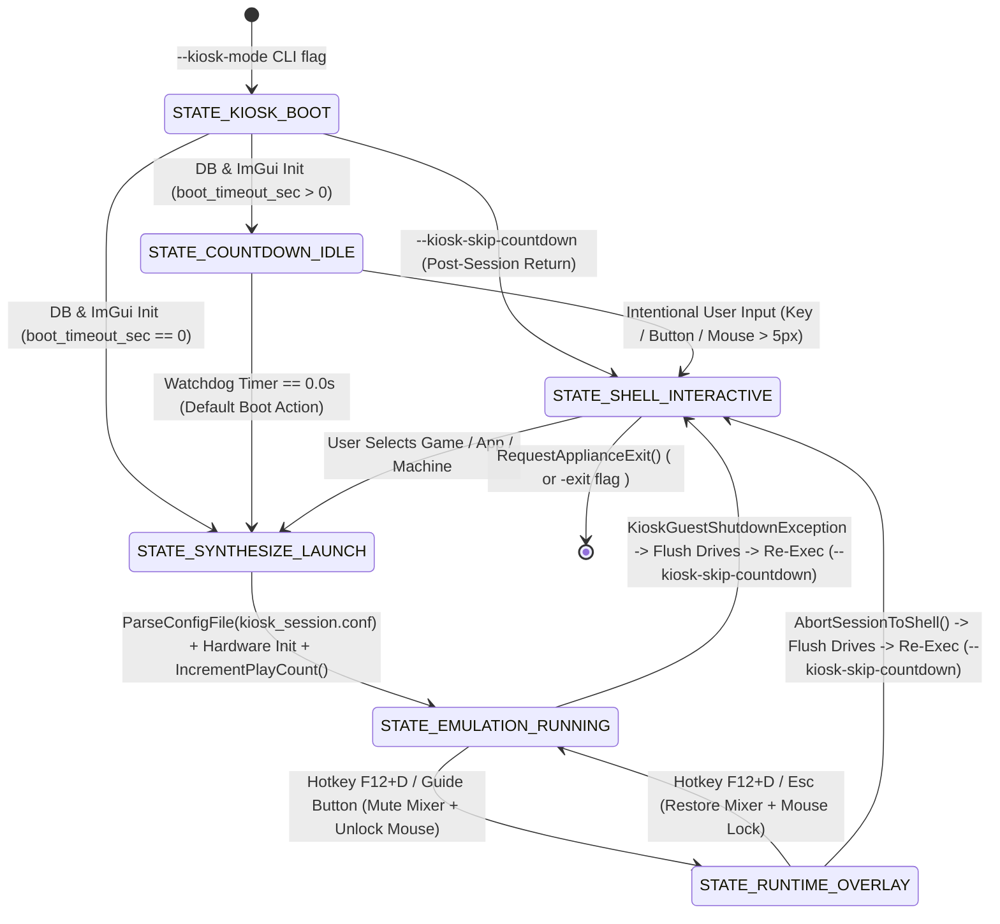

# Phase 2 Implementation Plan: Kiosk Lifecycle State Machine & Emulation Trapping

**Project:** DOSBox-X Kiosk Edition  
**Target Firmware Host:** Buildroot Linux Appliance  
**Development & Verification Platform:** Windows 10/11 (Visual Studio 2022/MSBuild, SDL2 x64) + Linux Autotools (`configure.ac` / `Makefile.am`)  
**Document Status:** Detailed Phase Execution Plan  
**Date:** October 31, 2026  
**Reference Documents:**
- [`docs/Kiosk/DOSBox-X_Kiosk_Implementation_Plan.md`](file:///C:/code/dosbox-x-kiosk/docs/Kiosk/DOSBox-X_Kiosk_Implementation_Plan.md#L151-L166)
- [`docs/Kiosk/DOSBox-X Kiosk Launcher Design.md`](file:///C:/code/dosbox-x-kiosk/docs/Kiosk/DOSBox-X%20Kiosk%20Launcher%20Design.md#L72-L84)
- [`docs/Kiosk/Phase1_Retrospective.md`](file:///C:/code/dosbox-x-kiosk/docs/Kiosk/Phase1_Retrospective.md)

---

## 1. Objective & Scope of Phase 2

Phase 2 transforms the skeleton [`KioskManager`](file:///C:/code/dosbox-x-kiosk/src/kiosk/kiosk_main.h#L9-L37) created in Phase 0 and the SQLite/Archetype/Synthesizer engine from Phase 1 into a functioning **6-state in-process lifecycle controller** with **non-terminating guest emulation trapping**.

In upstream DOSBox-X, hardware subsystems (`Init_RAM`, `VGA_Init`, `VOODOO_Init`, `SBLASTER_Init`, `IDE_Init`, `DOS_Init`, `AUTOEXEC_Init`, `VM_PowerOn`) are initialized **once** per process before `fresh_boot:`, and when a guest OS powers off via APM (`INT 15h AX=5307h CX=0003h`), ISA PnP (`INT 15h AH=41h`), or exits the integrated DOS shell, the emulator throws `int(0)` or `int(1)`, tears down SDL, and terminates the host OS process. In Kiosk mode, DOSBox-X uses a **Hybrid Lifecycle Architecture (Option 3)**:
1. Boot into the Kiosk state machine (`STATE_KIOSK_BOOT` &rarr; `STATE_COUNTDOWN_IDLE`, or directly to `STATE_SHELL_INTERACTIVE` when `--kiosk-skip-countdown` is passed after a session).
2. Run the Pre-Boot Shell (`KioskManager::RunMainLoop()`) right after SDL2/OpenGL window creation (`GUI_StartUp`) and **before** DOSBox-X's one-time hardware subsystem initialization (`Init_RAM`, `VGA_Init`, `VOODOO_Init`, `DOS_Init`, `VM_PowerOn`), with a configurable countdown watchdog (default 30 seconds) that cancels on intentional user input (`STATE_SHELL_INTERACTIVE`) or auto-launches the configured default target (`STATE_SYNTHESIZE_LAUNCH`).
3. Synthesize `kiosk_session.conf` and `kiosk_dispatch.img` for the selected machine or catalog item, apply `kiosk_session.conf` via `control->ParseConfigFile()`, and let `main()` initialize all 45+ hardware subsystems natively in-process (`STATE_EMULATION_RUNNING`) with **zero window recreation or display flicker**.
4. Support toggling into `STATE_RUNTIME_OVERLAY` (`F12+D` or Gamepad Guide button) by safely pausing audio DMA, releasing relative mouse lock, and halting guest CPU execution while keeping the OpenGL presentation loop active.
5. Intercept guest shutdown signals—including **APM 1.1/1.2 Power Off (`INT 15h AX=5307h CX=0003h`)**, **ISA PnP Power Off**, **Bochs/KIOSKEXT.COM Port `0x8900` (`"Shutdown"`)**, and **Integrated DOS Shell Exit**—via `KioskGuestShutdownException`, cleanly flush virtual drives (`DOS_ShutdownDrives()`, `FreeBIOSDiskList()`), delete `kiosk_dispatch.img`, and re-exec the binary with `--kiosk-mode --kiosk-skip-countdown` to return to `STATE_SHELL_INTERACTIVE` with a 100% clean hardware address space.

---

## 2. Architecture & State Flow Diagrams

### 2.1 6-State Kiosk Lifecycle Machine



### 2.2 Emulation Session Trap & Hybrid Re-Exec Sequence

```mermaid
sequenceDiagram
    participant SDL as sdlmain.cpp (Main Loop)
    participant KM as KioskManager
    participant CS as ConfigSynthesizer
    participant HW as DOSBox-X Hardware Init
    participant VM as DOSBOX_RunMachine()
    participant BIOS as bios.cpp (INT 15h / Port 0x8900)

    SDL->>KM: RunMainLoop() (After GUI_StartUp, Before Hardware Init)
    KM->>CS: SynthesizeConfig(machine, item, caddy, dispatch_img)
    CS-->>KM: Writes kiosk_session.conf + kiosk_dispatch.img
    KM->>SDL: control->ParseConfigFile(kiosk_session.conf)
    KM->>KM: SetState(STATE_EMULATION_RUNNING)
    SDL->>HW: One-Time Hardware Init (Init_RAM, VGA, VOODOO, SBLASTER, DOS, VM_PowerOn)
    SDL->>VM: try { DOSBOX_RunMachine(); }
    alt Real-Mode / Protected-Mode Guest OS (MS-DOS / Win9x)
        VM->>BIOS: INT 15h AX=5307h CX=0003h OR Out Port 0x8900 "Shutdown"
        BIOS->>SDL: throw KioskGuestShutdownException(reason)
    else Integrated DOS Container
        VM-->>SDL: SHELL_Run() exits on EXIT command
    end
    SDL->>KM: OnGuestShutdown(reason) & CleanupDispatchVolume()
    SDL->>SDL: DOS_ShutdownDrives(), FreeBIOSDiskList(), SDL_Quit()
    SDL->>SDL: Re-Exec (--kiosk-mode --kiosk-skip-countdown) -> STATE_SHELL_INTERACTIVE
```

---

## 3. Step-by-Step Implementation Plan

### Step 2.1: Core Kiosk Types & Shutdown Exception (`src/kiosk/kiosk_types.h`)

Add structured shutdown reason enums and `KioskGuestShutdownException` to [`src/kiosk/kiosk_types.h`](file:///C:/code/dosbox-x-kiosk/src/kiosk/kiosk_types.h):

```cpp
enum class KioskShutdownReason {
    NONE = 0,
    APM_POWER_OFF,        // INT 15h AX=5307h BX=0001h CX=0003h
    PORT_8900_SHUTDOWN,   // Bochs / KIOSKEXT.COM "Shutdown" sequence on I/O port 0x8900
    PNP_POWER_OFF,        // ISA PnP OS power-off (INT 15h AH=41h)
    SHELL_EXIT,           // Integrated DOS shell EXIT completion
    USER_OVERLAY_ABORT    // User selected "Quit to Kiosk Hub" in F12+D overlay
};

struct KioskGuestShutdownException {
    KioskShutdownReason reason;
    explicit KioskGuestShutdownException(KioskShutdownReason r = KioskShutdownReason::APM_POWER_OFF)
        : reason(r) {}
};
```

---

### Step 2.2: Kiosk Lifecycle State Machine (`src/kiosk/kiosk_main.h` & `src/kiosk/kiosk_main.cpp`)

Expand [`KioskManager`](file:///C:/code/dosbox-x-kiosk/src/kiosk/kiosk_main.h#L9-L37) from a Phase 0 stub into the complete 6-state controller:

- **Configuration & Watchdog Accessors**:
  - `float GetWatchdogRemainingSec() const`
  - `void SetWatchdogRemainingSec(float sec)`
  - `const KioskConfigRecord& GetConfig() const`
- **State Transition & Input Methods**:
  - `void UpdateWatchdog(float delta_sec)`
  - `void CancelWatchdog()`
  - `bool HandlePreBootInputEvent(const union SDL_Event& event)`
  - `static bool IsIntentionalUserInput(const union SDL_Event& event)`
  - `LaunchContext ResolveDefaultBootContext() const`
  - `bool TriggerDefaultBootAction()`
- **Launch & Session Lifecycle Methods**:
  - `bool RequestLaunchMachine(const std::string& machine_id, const std::string& custom_disk_path = "")`
  - `bool RequestLaunchItem(const std::string& item_id)`
  - `bool RequestDefaultDosboxLaunch()`
  - `bool SynthesizeAndPrepareLaunch(std::string& out_synthesized_conf)`
  - `void EnterRuntimeOverlay()`
  - `void ResumeEmulation()`
  - `void AbortSessionToShell()`
  - `void OnGuestShutdown(KioskShutdownReason reason)`
  - `void RequestApplianceExit()`
  - `bool IsExitRequested() const`
  - `KioskShutdownReason GetLastShutdownReason() const`
  - `int GetCompletedSessionCount() const`

#### Implementation Details (`src/kiosk/kiosk_main.cpp`)
- **`Initialize(db_path, base_conf)`**:
  - Opens [`KioskDatabase`](file:///C:/code/dosbox-x-kiosk/src/kiosk/kiosk_db.h) (with `:memory:` fallback), loads `KioskConfigRecord` via `GetConfig(m_config)`, initializes `m_watchdog_timer = static_cast<float>(m_config.boot_timeout_sec)`, and initializes [`KioskUI::InitializeContext()`](file:///C:/code/dosbox-x-kiosk/src/kiosk/ui/kiosk_ui.cpp#L21-L34).
  - Transitions from `STATE_KIOSK_BOOT` to `STATE_COUNTDOWN_IDLE` (if `m_config.boot_timeout_sec > 0`) or directly calls `TriggerDefaultBootAction()` (`STATE_SYNTHESIZE_LAUNCH`) if `boot_timeout_sec <= 0`.
- **`IsIntentionalUserInput(const SDL_Event& ev)`**:
  - Returns `true` on `SDL_KEYDOWN`, `SDL_MOUSEBUTTONDOWN`, `SDL_MOUSEWHEEL`, `SDL_CONTROLLERBUTTONDOWN`, `SDL_JOYBUTTONDOWN`.
  - Returns `true` on `SDL_MOUSEMOTION` only if `std::abs(ev.motion.xrel) >= 5 || std::abs(ev.motion.yrel) >= 5`.
  - Returns `true` on `SDL_CONTROLLERAXISMOTION` / `SDL_JOYAXISMOTION` only if `std::abs(ev.caxis.value) > 8000` (~25% deadzone).
- **`ResolveDefaultBootContext()`**:
  - Evaluates `m_config.default_boot_action`:
    - `"SPECIFIC_MACHINE"`: Looks up `m_config.default_target_uuid` in `KioskDatabase::GetMachine()`.
    - `"SPECIFIC_ITEM"`: Looks up `m_config.default_target_uuid` in `KioskDatabase::GetItem()` and resolves its parent `machine_id`.
    - `"LAST_PLAYED"`: Queries `GetItemsByType("GAME")` and `GetItemsByType("APPLICATION")` (ordered by `last_launched_at DESC`), picking the most recently launched item, or falls back to the first machine in `GetAllMachines()`.
    - `"DEFAULT_DOSBOX"` (or fallback when DB targets do not exist): Returns an `INTEGRATED_DOS` `LaunchContext` with empty `machine_id` and `catalog_item_id`.
- **`SynthesizeAndPrepareLaunch(std::string& out_synthesized_conf)`**:
  - Resolves `MachineRecord` (or constructs a default `ARCH_386DX` `INTEGRATED_DOS` machine record when `machine_id` is empty).
  - Resolves optional `CatalogItemRecord` and `CaddyBindingRecord` list (item caddy bindings take precedence; otherwise machine caddy bindings).
  - Calls `ConfigSynthesizer::GetInstance().SynthesizeConfig(...)`.
  - Writes the synthesized config to a temporary session file (`kiosk_session.conf`) if a path is configured, increments item play count (`IncrementPlayCount`), and transitions to `STATE_EMULATION_RUNNING`.
- **`EnterRuntimeOverlay()` / `ResumeEmulation()`**:
  - Validates state (`STATE_EMULATION_RUNNING` &harr; `STATE_RUNTIME_OVERLAY`).
  - Manages mixer mute and mouse unlock callbacks when hooked to SDL runtime.
- **`OnGuestShutdown(KioskShutdownReason reason)`**:
  - Records `m_last_shutdown_reason = reason` and increments `m_completed_sessions`.
  - Clears transient `m_launch_ctx` and transitions to `STATE_SHELL_INTERACTIVE`.

---

### Step 2.3: BIOS APM & Port `0x8900` Shutdown Interception (`src/ints/bios.cpp`)

Hook DOSBox-X's APM BIOS, ISA PnP BIOS, and Bochs Port `0x8900` in [`src/ints/bios.cpp`](file:///C:/code/dosbox-x-kiosk/src/ints/bios.cpp) to throw `KioskGuestShutdownException` when Kiosk mode is active:

1. **Include Kiosk Header**:
   ```cpp
   #if defined(C_KIOSK)
   #include "kiosk/kiosk_main.h"
   #endif
   ```
2. **Port `0x8900` ("Shutdown") Hardware Handler**:
   - Follow the existing `BOCHS_PORT_E9` pattern ([`src/ints/bios.cpp:448-467`](file:///C:/code/dosbox-x-kiosk/src/ints/bios.cpp#L448-L467), [`1596`](file:///C:/code/dosbox-x-kiosk/src/ints/bios.cpp#L1596), [`10338-10350`](file:///C:/code/dosbox-x-kiosk/src/ints/bios.cpp#L10338-L10350), [`12838-12841`](file:///C:/code/dosbox-x-kiosk/src/ints/bios.cpp#L12838-L12841)):
   ```cpp
   #if defined(C_KIOSK)
   static IO_WriteHandleObject *BOCHS_PORT_8900 = NULL;
   static size_t bochs_port_8900_idx = 0;
   static const char bochs_port_8900_seq[9] = "Shutdown";

   void Kiosk_ResetPort8900State(void) {
       bochs_port_8900_idx = 0;
   }

   void bochs_port_8900_write(Bitu /*port*/, Bitu val, Bitu /*iolen*/) {
       const char c = static_cast<char>(val & 0xFFu);
       if (c == bochs_port_8900_seq[bochs_port_8900_idx]) {
           bochs_port_8900_idx++;
           if (bochs_port_8900_idx == 8) {
               bochs_port_8900_idx = 0;
               LOG_MSG("KIOSK: Caught Port 0x8900 ('Shutdown') hardware power-off signal.");
               if (KioskManager::GetInstance().IsKioskModeActive()) {
                   throw KioskGuestShutdownException(KioskShutdownReason::PORT_8900_SHUTDOWN);
               }
               throw int(0);
           }
       } else if (c == bochs_port_8900_seq[0]) {
           bochs_port_8900_idx = 1;
       } else {
           bochs_port_8900_idx = 0;
       }
   }
   #endif
   ```
   - Install `BOCHS_PORT_8900` on port `0x8900` (`IO_MB`) in `BIOS` setup alongside `BOCHS_PORT_E9`, and free it in `~BIOS()`.
3. **APM BIOS `INT 15h AX=5307h CX=0003h` Interception ([`src/ints/bios.cpp:7548`](file:///C:/code/dosbox-x-kiosk/src/ints/bios.cpp#L7548))**:
   ```cpp
   case 0x3: // power off
   #if defined(C_KIOSK)
       if (KioskManager::GetInstance().IsKioskModeActive()) {
           LOG_MSG("KIOSK: Caught Guest OS APM Power-Off Request (INT 15h AX=5307h CX=0003h).");
           throw KioskGuestShutdownException(KioskShutdownReason::APM_POWER_OFF);
       }
   #endif
       throw 0;
   ```
4. **ISA PnP Power-Off Interception ([`src/ints/bios.cpp:2714`](file:///C:/code/dosbox-x-kiosk/src/ints/bios.cpp#L2714))**:
   ```cpp
   case 0x41:
       LOG_MSG("Plug & Play OS requested power off.\n");
       reg_ax = 0;
   #if defined(C_KIOSK)
       if (KioskManager::GetInstance().IsKioskModeActive()) {
           throw KioskGuestShutdownException(KioskShutdownReason::PNP_POWER_OFF);
       }
   #endif
       throw 1;
   ```

---

### Step 2.4: SDL2 Main Loop, UI Backend Attachment & Emulation Trap (`src/gui/sdlmain.cpp` & `src/kiosk/ui/kiosk_ui.h/.cpp`)

Connect `KioskUI` and `KioskManager` to the SDL2/OpenGL window lifecycle and wrap `DOSBOX_RunMachine()` in the Kiosk trap block:

1. **State-Aware Render Dispatch in `KioskUI` (`src/kiosk/ui/kiosk_ui.h` & `.cpp`)**:
   - Add state-aware placeholder renderers (which Phase 4 and Phase 5 will expand into the full skeuomorphic caddy and cover-flow carousels):
     - `void RenderCountdownBanner(float remaining_sec)`
     - `void RenderInteractiveShellPlaceholder()`
     - `void RenderRuntimeOverlayPlaceholder()`
     - `void CompositeActiveState()`: If `m_backend_initialized`, calls `NewFrame()`, dispatches to the active state renderer (`STATE_COUNTDOWN_IDLE`, `STATE_SHELL_INTERACTIVE`, or `STATE_RUNTIME_OVERLAY`), and calls `RenderFrame()`.
2. **Deferred OpenGL Backend Initialization ([`src/gui/sdlmain.cpp:1904`](file:///C:/code/dosbox-x-kiosk/src/gui/sdlmain.cpp#L1904) & [`1961`](file:///C:/code/dosbox-x-kiosk/src/gui/sdlmain.cpp#L1961))**:
   - When `sdl_opengl.context` is created and made current in `GFX_SetSize()`, if `KioskManager::GetInstance().IsKioskModeActive() && !KioskUI::GetInstance().IsBackendInitialized()`, call `KioskUI::GetInstance().InitializeBackend(sdl.window, sdl_opengl.context)`.
3. **Hotkey (`F12+D` / Guide Button) & Event Routing in `GFX_Events()` ([`src/gui/sdlmain.cpp:5962`](file:///C:/code/dosbox-x-kiosk/src/gui/sdlmain.cpp#L5962))**:
   - When `KioskManager::GetInstance().IsKioskModeActive()`:
     - Handle `SDL_QUIT` by calling `KioskManager::GetInstance().RequestApplianceExit()`.
     - Detect `F12+D` (`event.type == SDL_KEYDOWN && event.key.keysym.sym == SDLK_d && SDL_GetKeyboardState(NULL)[SDL_SCANCODE_F12]`) or `SDL_CONTROLLERBUTTONDOWN` (`SDL_CONTROLLER_BUTTON_GUIDE`):
       - Toggle between `STATE_EMULATION_RUNNING` (`EnterRuntimeOverlay()`) and `STATE_RUNTIME_OVERLAY` (`ResumeEmulation()`).
     - When in `STATE_COUNTDOWN_IDLE`, `STATE_SHELL_INTERACTIVE`, or `STATE_RUNTIME_OVERLAY`, pass events to `KioskUI::GetInstance().ProcessEvent(&event)` and `KioskManager::GetInstance().HandlePreBootInputEvent(event)`.
4. **OpenGL Frame Compositing ([`src/gui/sdlmain.cpp:10925`](file:///C:/code/dosbox-x-kiosk/src/gui/sdlmain.cpp#L10925))**:
   - In `SDL_GL_SwapBuffers()`, prior to `SDL_GL_SwapWindow(sdl.window)`, if `KioskManager::GetInstance().IsKioskModeActive()`, invoke `KioskUI::GetInstance().CompositeActiveState()` when the state is `STATE_COUNTDOWN_IDLE`, `STATE_SHELL_INTERACTIVE`, or `STATE_RUNTIME_OVERLAY`.
5. **Pre-Hardware-Init Shell Hook, Emulation Trap Block & Post-Session Re-Exec ([`src/gui/sdlmain.cpp`](file:///C:/code/dosbox-x-kiosk/src/gui/sdlmain.cpp))**:
   - **Pre-Boot Shell Hook (Before Line 9855 Hardware Init)**: Right after `GUI_StartUp()` creates the SDL2/OpenGL window, run `KioskManager::GetInstance().RunMainLoop()` to pump `STATE_COUNTDOWN_IDLE` / `STATE_SHELL_INTERACTIVE` until a launch target is selected (`STATE_SYNTHESIZE_LAUNCH`), then call `control->ParseConfigFile(session_conf_path)` so all 45+ hardware subsystems initialize in-process with zero display flicker.
   - **Emulation Trap & Clean Re-Exec (Lines 10339–10830)**:
     - Catch `const KioskGuestShutdownException& e`:
       - Log the shutdown reason (`APM_POWER_OFF`, `PORT_8900_SHUTDOWN`, `PNP_POWER_OFF`, `SHELL_EXIT`, `USER_OVERLAY_ABORT`).
       - Set `dos_kernel_shutdown = !dos_kernel_disabled; run_machine = false;`.
       - Notify `KioskManager::GetInstance().OnGuestShutdown(e.reason)` (which cleans up `kiosk_dispatch.img`), perform normal guest drive/BIOS disk teardown (`DOS_ShutdownDrives()`, `FreeBIOSDiskList()`, `Kiosk_ResetPort8900State()`, `SDL_Quit()`), and if `!control->opt_exit && !control->opt_test && !KioskManager::GetInstance().IsExitRequested()`, re-exec the binary with `--kiosk-mode --kiosk-skip-countdown` to return cleanly to `STATE_SHELL_INTERACTIVE`.

---

### Step 2.5: Unit Tests (`tests/kiosk_tests.cpp`)

Extend [`tests/kiosk_tests.cpp`](file:///C:/code/dosbox-x-kiosk/tests/kiosk_tests.cpp) with 6 new Google Test suites verifying Phase 2 functionality in isolation:

1. `KioskLifecycleTest.BootToCountdownAndWatchdogExpiration`:
   - Configures `boot_timeout_sec = 15`, initializes `KioskManager`, verifies initial state is `STATE_COUNTDOWN_IDLE` with `15.0f` remaining.
   - Calls `UpdateWatchdog(5.0f)` &rarr; verifies `10.0f` remaining and state still `STATE_COUNTDOWN_IDLE`.
   - Calls `UpdateWatchdog(10.0f)` &rarr; verifies transition to `STATE_SYNTHESIZE_LAUNCH`.
2. `KioskLifecycleTest.WatchdogCancellationOnIntentionalInput`:
   - Synthesizes `SDL_Event` structs:
     - Small `SDL_MOUSEMOTION` (`xrel = 2, yrel = 1`) &rarr; ignored (`STATE_COUNTDOWN_IDLE` preserved).
     - Small `SDL_CONTROLLERAXISMOTION` (`value = 3000`) &rarr; ignored (`STATE_COUNTDOWN_IDLE` preserved).
     - `SDL_KEYDOWN` (`SDLK_SPACE`) &rarr; cancels countdown and transitions to `STATE_SHELL_INTERACTIVE`.
3. `KioskLifecycleTest.ResolveDefaultBootActions`:
   - Seeds machines and catalog items into `:memory:` DB and tests `ResolveDefaultBootContext()` across `DEFAULT_DOSBOX`, `SPECIFIC_MACHINE`, `SPECIFIC_ITEM`, and `LAST_PLAYED` (plus fallback when a configured UUID no longer exists).
4. `KioskLifecycleTest.SynthesizeLaunchAndTelemetryUpdate`:
   - Calls `RequestLaunchItem("game-doom2")`, verifies transition to `STATE_SYNTHESIZE_LAUNCH`, calls `SynthesizeAndPrepareLaunch(conf_out)`, verifies `conf_out` contains the expected `[autoexec]`, verifies `play_count` incremented in SQLite, and verifies state transitions to `STATE_EMULATION_RUNNING`.
5. `KioskLifecycleTest.RuntimeOverlayStateTransitions`:
   - From `STATE_EMULATION_RUNNING`, calls `EnterRuntimeOverlay()` &rarr; verifies `STATE_RUNTIME_OVERLAY`.
   - Calls `ResumeEmulation()` &rarr; verifies `STATE_EMULATION_RUNNING`.
   - Calls `EnterRuntimeOverlay()` then `AbortSessionToShell()` &rarr; verifies transition to `STATE_SHELL_INTERACTIVE` with `USER_OVERLAY_ABORT`.
6. `KioskLifecycleTest.Port8900ShutdownSequenceAndGuestTrap`:
   - Tests `bochs_port_8900_write` with partial string `"ShutX"` followed by `"Shutdown"`.
   - Verifies that `"ShutX"` resets the matcher without throwing, and the subsequent 8 bytes `"Shutdown"` throw `KioskGuestShutdownException` with `reason == KioskShutdownReason::PORT_8900_SHUTDOWN`.
   - Verifies `OnGuestShutdown(e.reason)` transitions `KioskManager` back to `STATE_SHELL_INTERACTIVE` and increments `GetCompletedSessionCount()`.

---

## 4. Verification Plan

1. **Compile `Debug SDL2|x64` via `msbuild-runner`:**
   ```powershell
   powershell -ExecutionPolicy Bypass -File .agents/skills/msbuild-runner/scripts/build.ps1 -Configuration "Debug SDL2" -Platform "x64"
   ```
2. **Compile Legacy Non-SDL2 `Debug|x64` Regression Check:**
   ```powershell
   powershell -ExecutionPolicy Bypass -File .agents/skills/msbuild-runner/scripts/build.ps1 -Configuration "Debug" -Platform "x64"
   ```
3. **Execute Google Test Suite (`Kiosk*`):**
   ```powershell
   powershell -ExecutionPolicy Bypass -File .agents/skills/dosbox-config-tester/scripts/test-kiosk.ps1 -Tests -TestFilter "Kiosk*"
   ```
4. **Execute Runtime Kiosk CLI Verification:**
   ```powershell
   powershell -ExecutionPolicy Bypass -File .agents/skills/dosbox-config-tester/scripts/test-kiosk.ps1
   ```
5. **Adversarial Pre-Commit Code Review:**
   - Invoke the `code-reviewer` subagent against `git diff master` to verify C++14 compliance, thread safety, SDL2/non-SDL2 guards, and lifecycle soundness.
