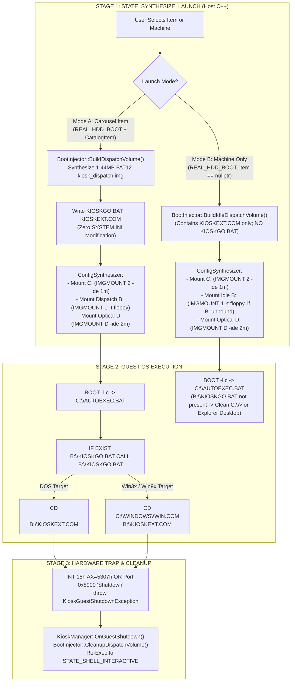
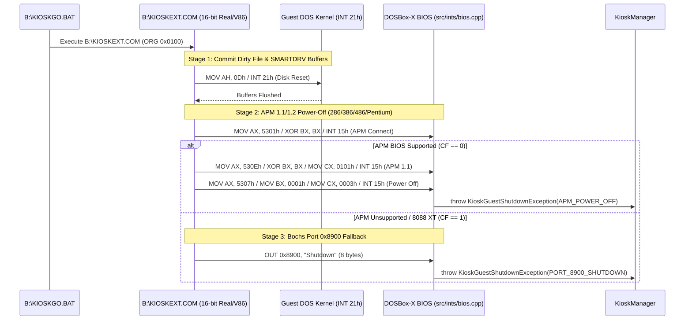

# Phase 3 Implementation Plan: Ephemeral Boot Injector & Guest Return Mechanism

**Project:** DOSBox-X Kiosk Edition  
**Target Firmware Host:** Buildroot Linux Appliance  
**Development & Verification Platform:** Windows 10/11 (Visual Studio 2022/MSBuild, SDL2 x64) + Linux Autotools (`configure.ac` / `Makefile.am`)  
**Document Status:** Detailed Phase Execution Plan  
**Date:** November 1, 2026  
**Reference Documents:**
- [`docs/Kiosk/DOSBox-X_Kiosk_Implementation_Plan.md`](./DOSBox-X_Kiosk_Implementation_Plan.md#L169-L188)
- [`docs/Kiosk/DOSBox-X Kiosk Launcher Design.md`](./DOSBox-X%20Kiosk%20Launcher%20Design.md#L803-L1040)
- [`docs/Kiosk/Phase2_Retrospective.md`](./Phase2_Retrospective.md)

---

## 1. Objective & Scope of Phase 3

Phase 3 delivers the **Non-Destructive Ephemeral Boot Injector & Guest Return Mechanism**. When a user launches a specific Game or Application from the Kiosk Carousel that resides on a real bootable hard disk image (`boot_mode == "REAL_HDD_BOOT"` running MS-DOS, FreeDOS, Windows 3.1x, or Windows 95/98), DOSBox-X cannot simply execute a host command line—control is handed to the guest MBR via `BOOT -l c`.

Directly modifying `C:\AUTOEXEC.BAT` or `C:\WINDOWS\SYSTEM.INI` inside `hdd_c.img` before every session risks persistent disk corruption if power is lost or the guest crashes mid-game. Furthermore, mounting an extra IDE hard disk (`-ide 1s`) would occupy drive `D:` and shift the guest's CD-ROM drive to `E:`, breaking CD-ROM games that hardcode `D:\` in their configuration files.

Phase 3 solves both problems by introducing a **One-Time Boot Hook + Ephemeral FAT12 Dispatch Floppy (`B:` via `IMGMOUNT 1`)** architecture:
1. **Zero Drive-Letter Shift (`B:` via `IMGMOUNT 1`):** In IBM PC / MS-DOS / Windows 9x architecture, drive letters `A:` and `B:` are permanently reserved for Floppy Disk Controller drives (`INT 13h` `00h` and `01h`) before any hard disk (`C:`) or CD-ROM (`D:`) letters are assigned. Mounting the 1.44MB FAT12 `kiosk_dispatch.img` on **Floppy Drive `B:` (`IMGMOUNT 1 "<path>" -t floppy -fs none`)** guarantees that **`C:` (Primary HDD) and `D:` (Primary CD-ROM) never shift**.
2. **Primary HDD (`C:`)** receives a one-time idempotent trailer in `C:\AUTOEXEC.BAT`: `IF EXIST B:\KIOSKGO.BAT CALL B:\KIOSKGO.BAT`.
3. **Mode A (Carousel Game/App Launch):** `kiosk_dispatch.img` is synthesized in `<5ms` as a native 1.44MB FAT12 floppy image and populated with `KIOSKGO.BAT` and `KIOSKEXT.COM` (16-bit DOS cache flush + APM 1.1/1.2 + Bochs Port `0x8900` shutdown binary). For Windows 3.1x (`WIN3X_PROGMAN_HOOK`) and Windows 95/98 (`WIN9X_RUNONCE_HOOK`) targets, `KIOSKGO.BAT` invokes `C:\WINDOWS\WIN.COM <guest_executable> [guest_arguments]` directly without mutating `C:\WINDOWS\SYSTEM.INI`. When the user exits the game or application (or exits Windows), `KIOSKEXT.COM` flushes guest disk caches and triggers hardware power-off, which Phase 2's `KioskGuestShutdownException` trap catches to return seamlessly to `STATE_SHELL_INTERACTIVE`.
4. **Mode B (Machine Boot to Prompt/Desktop):** When booting a Machine directly (no `CatalogItemRecord`), if the user has not bound a custom floppy to `B:`, an empty `kiosk_dispatch.img` (containing only `KIOSKEXT.COM` and **no** `KIOSKGO.BAT`) is mounted on `IMGMOUNT 1`. This registers a physical second floppy drive in the BIOS Equipment Word (`0040:0010`) so MS-DOS never triggers the single-drive `"Insert diskette for drive B:"` phantom-drive prompt, and `IF EXIST B:\KIOSKGO.BAT` silently evaluates to `false` in `<1ms`, booting cleanly to `C:\>` or the Windows Explorer desktop.

---

## 2. Key Design Refinements

> [!IMPORTANT]
> **Why Floppy Drive `B:` (`IMGMOUNT 1`) Instead of Primary IDE Slave (`-ide 1s` / `D:`)**:
> 1. **Preserves `D:` for CD-ROM Games**: Hundreds of DOS and Windows 95/98 CD-ROM titles record `D:\` inside their `.CFG`/`.INI`/Registry paths during installation. Using `IMGMOUNT 1` (`B:`) leaves `C:` (Primary IDE Master HDD) and `D:` (Secondary IDE Master CD-ROM) 100% untouched.
> 2. **Native 1.44MB FAT12 Geometry**: Because a 1.44MB FAT12 image (80 tracks, 2 heads, 18 sectors/track, 512 bytes/sector) is a standard 3.5" microfloppy format, mounting it via `IMGMOUNT 1 "<path>" -t floppy -fs none` requires no synthetic HDD CHS translation.
> 3. **Eliminates DOS Phantom-Drive `B:` Prompts**: By mounting an idle (no-`KIOSKGO.BAT`) dispatch image on `IMGMOUNT 1` during Machine-Only boots whenever the user hasn't bound their own `B:` floppy, BIOS `INT 11h` reports 2 floppy drives present. Consequently, `IF EXIST B:\KIOSKGO.BAT` checks `INT 13h DL=01h` directly without prompting the user to swap diskettes in `A:`.

> [!IMPORTANT]
> **Assembly Offset Correction in `KIOSKEXT.COM` (`kioskext_bin.h`)**:
> In the original design sketch ([`DOSBox-X Kiosk Launcher Design.md`](./DOSBox-X%20Kiosk%20Launcher%20Design.md#L987-L1011)), the `jc bochs_fallback` instruction used displacement `0x14` (`72 14`) and `mov si, shutdown_str` used `0x0128` (`BE 28 01`). However, the APM 1.1 negotiation + `5307h` power-off sequence between `0x010D` and `bochs_fallback` is **21 bytes (`0x15`)**, not 20 (`0x14`). With `72 14`, an 8088 XT (where `INT 15h AX=5301h` sets Carry) jumps into the middle of the `CD 15` instruction at `0x0121` instead of `mov dx, 0x8900` at `0x0122`.
>
> In this plan, we correct the relative jump to `0x72, 0x15` (`jc +21` -> `0x0122`), include the safety `ret` (`0xC3`) at `0x0130`, and point `SI` to `0x0131` (`0xBE, 0x31, 0x01`), yielding a verified **57-byte** `KIOSKEXT.COM` binary (with a unit test verifying exact opcode offsets and simulated Port `0x8900` execution).

> [!NOTE]
> **Self-Contained Userspace FAT12 Generator & Injector**:
> Rather than invoking interactive DOS shell commands (`IMGMAKE` / `MOUNT`) during pre-boot config synthesis, [`BootInjector`](../../src/kiosk/machine/boot_injector.h) synthesizes the 1.44MB FAT12 image (2,880 sectors $\times$ 512 bytes = 1,474,560 bytes) and performs one-time `AUTOEXEC.BAT` hook injection directly in userspace C++14. This allows deterministic, sub-5ms unit testing in Google Test without requiring a live emulated CPU loop.

---

## 3. Architecture & Execution Flow

### 3.1 Ephemeral Dispatch Floppy (`B:` via `IMGMOUNT 1`) Architecture



### 3.2 `KIOSKEXT.COM` 3-Stage Shutdown Sequence



---

## 4. Proposed Changes by Component

### Component 1: Embedded Guest Shutdown & Wrapper Binaries

Provide deterministic, header-only `constexpr` binary payloads for `KIOSKEXT.COM` and `KIOSKWIN.EXE` so DOSBox-X Kiosk Edition never depends on external runtime binary files on the host filesystem.

#### [NEW] [`src/kiosk/machine/kioskext_bin.h`](../../src/kiosk/machine/kioskext_bin.h)

- Defines `KIOSKEXT_COM_BYTES` (57 bytes) with verified x86 machine code:
  ```cpp
  #ifndef DOSBOX_KIOSK_EXT_BIN_H
  #define DOSBOX_KIOSK_EXT_BIN_H

  #include <cstdint>
  #include <cstddef>

  // ============================================================================
  // KIOSKEXT.COM - 57-Byte DOSBox-X Kiosk Clean Shutdown Utility (ORG 0x0100)
  // Compatible with: 8088, 286, 386, 486, Pentium (Real Mode & V86 Mode)
  // ============================================================================
  // Offset  Bytes                  Instruction
  // 0x0100  B4 0D                  mov ah, 0x0D        ; DOS Flush File Buffers
  // 0x0102  CD 21                  int 0x21            ; Commit dirty FAT sectors
  // 0x0104  B8 01 53               mov ax, 0x5301      ; APM Real-Mode Connect
  // 0x0107  31 DB                  xor bx, bx          ; Device ID 0000h (BIOS)
  // 0x0109  CD 15                  int 0x15
  // 0x010B  72 15                  jc 0x0122           ; Jump +21 to bochs_fallback
  // 0x010D  B8 0E 53               mov ax, 0x530E      ; APM Driver Version
  // 0x0110  31 DB                  xor bx, bx          ; Device ID 0000h
  // 0x0112  B9 01 01               mov cx, 0x0101      ; Request APM v1.1
  // 0x0115  CD 15                  int 0x15
  // 0x0117  B8 07 53               mov ax, 0x5307      ; APM Set Power State
  // 0x011A  BB 01 00               mov bx, 0x0001      ; All devices (0001h)
  // 0x011D  B9 03 00               mov cx, 0x0003      ; Power Off (0003h)
  // 0x0120  CD 15                  int 0x15            ; Traps in bios.cpp
  // bochs_fallback (0x0122):
  // 0x0122  BA 00 89               mov dx, 0x8900      ; Bochs shutdown port
  // 0x0125  BE 31 01               mov si, 0x0131      ; Address of "Shutdown"
  // 0x0128  B9 08 00               mov cx, 0x0008      ; 8 bytes
  // 0x012B  FC                     cld
  // 0x012C  AC                     lodsb               ; AL = [DS:SI++]
  // 0x012D  EE                     out dx, al          ; Write to port 0x8900
  // 0x012E  E2 FC                  loop 0x012C         ; Repeat 8 times
  // 0x0130  C3                     ret                 ; Safety return
  // shutdown_str (0x0131):
  // 0x0131  53 68 75 74 64 6F 77 6E "Shutdown"
  static constexpr size_t KIOSKEXT_COM_SIZE = 57;
  static constexpr uint8_t KIOSKEXT_COM_BYTES[KIOSKEXT_COM_SIZE] = {
      0xB4, 0x0D, 0xCD, 0x21,
      0xB8, 0x01, 0x53, 0x31, 0xDB, 0xCD, 0x15,
      0x72, 0x15,
      0xB8, 0x0E, 0x53, 0x31, 0xDB, 0xB9, 0x01, 0x01, 0xCD, 0x15,
      0xB8, 0x07, 0x53, 0xBB, 0x01, 0x00, 0xB9, 0x03, 0x00, 0xCD, 0x15,
      0xBA, 0x00, 0x89, 0xBE, 0x31, 0x01, 0xB9, 0x08, 0x00,
      0xFC, 0xAC, 0xEE, 0xE2, 0xFC, 0xC3,
      'S', 'h', 'u', 't', 'd', 'o', 'w', 'n'
  };

  #endif // DOSBOX_KIOSK_EXT_BIN_H
  ```

---

### Component 2: Ephemeral FAT12 Dispatch Floppy (`B:`) & Boot Injector

Implement [`BootInjector`](../../src/kiosk/machine/boot_injector.h) to synthesize the 1.44MB FAT12 dispatch floppy (`B:`), generate `KIOSKGO.BAT` (for DOS, Windows 3.1x, and Windows 95/98 targets with zero `SYSTEM.INI` mutation), and perform idempotent one-time `C:\AUTOEXEC.BAT` hooking.

#### [NEW] [`src/kiosk/machine/boot_injector.h`](../../src/kiosk/machine/boot_injector.h)
#### [NEW] [`src/kiosk/machine/boot_injector.cpp`](../../src/kiosk/machine/boot_injector.cpp)

```cpp
#ifndef DOSBOX_KIOSK_BOOT_INJECTOR_H
#define DOSBOX_KIOSK_BOOT_INJECTOR_H

#include "kiosk_types.h"
#include <string>
#include <vector>
#include <cstdint>

struct DispatchFileEntry {
    std::string filename_8_3; // e.g., "KIOSKGO.BAT", "KIOSKEXT.COM"
    std::vector<uint8_t> data;
};

class BootInjector {
public:
    static BootInjector& GetInstance();

    // Returns canonical one-time hook marker and command lines for C:\AUTOEXEC.BAT
    static const char* GetAutoexecHookMarker();
    static std::string GetAutoexecHookBlock();

    // Idempotently appends the one-time B:\KIOSKGO.BAT hook to an AUTOEXEC.BAT string
    static std::string InjectAutoexecHookToString(const std::string& existing_content);
    static bool HasAutoexecHook(const std::string& content);

    // One-time guest boot hooker for a raw FAT12/FAT16/FAT32 HDD image file or host file
    bool EnsureOneTimeAutoexecHook(const std::string& hdd_or_autoexec_path) const;

    // Synthesizes B:\KIOSKGO.BAT content for DOS, Win3.1x, or Win9x targets
    // (using C:\WINDOWS\WIN.COM <guest_executable> [guest_arguments] for Windows targets with zero SYSTEM.INI mutation)
    std::string SynthesizeKioskGoBat(
        const MachineRecord& machine,
        const CatalogItemRecord& item
    ) const;

    // Builds a complete 1.44MB (1,474,560-byte) FAT12 floppy image in memory
    // containing the provided root directory files (up to 224 entries).
    bool BuildFat12ImageInMemory(
        const std::vector<DispatchFileEntry>& files,
        std::vector<uint8_t>& out_image_bytes,
        const std::string& volume_label = "KIOSKDISP  "
    ) const;

    // Reads a file back from an in-memory or on-disk FAT12 image (used for verification & hooks)
    bool ReadFileFromFat12Image(
        const std::vector<uint8_t>& image_bytes,
        const std::string& filename_8_3,
        std::vector<uint8_t>& out_file_data
    ) const;

    // Generates the active dispatch floppy image on disk for a Carousel item launch (Mode A)
    bool BuildDispatchVolume(
        const std::string& output_image_path,
        const MachineRecord& machine,
        const CatalogItemRecord& item
    ) const;

    // Generates an idle dispatch floppy image (KIOSKEXT.COM only, no KIOSKGO.BAT)
    // for Machine-Only boots (Mode B) so BIOS reports 2 floppy drives and skips B: phantom prompts
    bool BuildIdleDispatchVolume(
        const std::string& output_image_path
    ) const;

    // Resolves default temporary path for kiosk_dispatch.img
    std::string GetDefaultDispatchImagePath() const;

    // Removes temporary dispatch image file on session end
    bool CleanupDispatchVolume(const std::string& image_path) const;

private:
    BootInjector() = default;
};

#endif // DOSBOX_KIOSK_BOOT_INJECTOR_H
```

##### Key Implementation Details in `boot_injector.cpp`:
1. **One-Time `C:\AUTOEXEC.BAT` Hook (`GetAutoexecHookBlock` & `EnsureOneTimeAutoexecHook`)**:
   ```bat
   REM --- DOSBOX-X KIOSK DISPATCH HOOK (DO NOT REMOVE) ---
   IF EXIST B:\KIOSKGO.BAT CALL B:\KIOSKGO.BAT
   ```
   - **Plain Text File Mode**: If `hdd_or_autoexec_path` is `< 64 KB` or does not contain a `0x55 0xAA` boot signature at offset `0x1FE`, treat it as a host-side `AUTOEXEC.BAT` text file, read its contents, apply `InjectAutoexecHookToString()`, and write it back if modified.
   - **Raw Disk Image Mode (`FAT12` / `FAT16` / `FAT32` with or without MBR)**:
     - Inspect sector 0 (`0x0000..0x01FF`): if it begins with a valid FAT BPB jump (`EB xx 90` or `E9 xx xx`) and valid `BytsPerSec == 512`, `NumFATs` (`1` or `2`), use partition LBA `0` (unpartitioned/superfloppy image). Otherwise, parse the 4 MBR partition table entries at `0x1BE..0x1FD` and select the first active/valid FAT12/FAT16/FAT32 partition's `LBAStart` (`partition_offset = LBAStart * 512`).
     - Locate `"AUTOEXECBAT"` in the root directory (scanning fixed root directory sectors for FAT12/FAT16, or walking the `BPB_RootClus` cluster chain for FAT32):
       - **Existing `AUTOEXEC.BAT`**: Read its cluster chain and check `HasAutoexecHook()`. If already present, return `true` without modifying the image (`0` disk writes). Otherwise, append the hook via `InjectAutoexecHookToString()`. If the new size fits within the currently allocated cluster chain, write the updated tail bytes in-place and update the 32-bit `DIR_FileSize` in its root directory entry; if it crosses a cluster boundary, allocate the next free cluster (`0x000` / `0x0000` / `0x00000000`) across all FAT copies, write the overflow bytes, and update `DIR_FileSize`.
       - **Missing `AUTOEXEC.BAT`**: Allocate 1 free cluster in all FAT copies, write the hook block to that cluster, and populate the first free (`0x00` or `0xE5`) root directory entry with `"AUTOEXECBAT"`, `attr = 0x20`, starting cluster, and `DIR_FileSize`.
2. **In-Memory 1.44MB FAT12 Synthesizer (`BuildFat12ImageInMemory`)**:
   - Allocates 1,474,560 bytes (`2880` sectors $\times$ `512` bytes) zero-initialized.
   - **Sector 0 (Boot Sector / BPB)**:
     - Jump instruction: `EB 3C 90`, OEM Name: `"MSDOS5.0"`.
     - `BytsPerSec = 512`, `SecPerClus = 1`, `RsvdSecCnt = 1`, `NumFATs = 2`, `RootEntCnt = 224` (14 sectors), `TotSec16 = 2880`, `Media = 0xF0`, `FATSz16 = 9`, `SecPerTrk = 18`, `NumHeads = 2`.
     - Extended Boot Signature `0x29`, Volume Label `"KIOSKDISP  "`, FileSystem Type `"FAT12   "`, Boot Signature `0x55 0xAA` at offset `0x1FE`.
   - **Sectors 1–9 (FAT #1) & Sectors 10–18 (FAT #2)**:
     - Initializes reserved entries 0 and 1 to `0xFF0` / `0xFFF` (`F0 FF FF`).
     - Allocates contiguous clusters starting at cluster `2` (LBA sector `33` = `1 + 18 + 14`) for each non-empty `DispatchFileEntry`, encoding 12-bit FAT cluster chains (`0xFFF` end-of-chain) identically into both FAT #1 and FAT #2.
   - **Sectors 19–32 (Root Directory, 224 entries $\times$ 32 bytes)**:
     - Writes volume label entry at index 0 (`attr = 0x08`).
     - Normalizes each filename into 11-byte space-padded 8.3 uppercase (`"KIOSKGO BAT"`, `"KIOSKEXTCOM"`), sets `attr = 0x20` (Archive), `FstClusLO`, and `FileSize`.
3. **Target-Aware `B:\KIOSKGO.BAT` Synthesis (`SynthesizeKioskGoBat`)**:
   - **Drive & Working Directory Parsing**: Inspects `item.guest_working_dir`; if it starts with a drive letter prefix (`<Drive>:` such as `C:` or `D:`), emits `<Drive>:` as the active drive switch and strips `<Drive>:` from the `CD <path>` command (defaulting to `C:` if no drive prefix is specified).
   - **DOS / Integrated Targets (`DOS_AUTOEXEC_INJECT` / `INTEGRATED_AUTOEXEC`)**:
     ```bat
     @ECHO OFF
     CLS
     C:
     CD \GAMES\DOOM2
     DOOM2.EXE -warp 01
     B:\KIOSKEXT.COM
     ```
     *(If `item.return_on_exit == false`, omits `B:\KIOSKEXT.COM` so the user remains at the guest prompt after quitting.)*
   - **Windows 3.1x (`WIN3X_PROGMAN_HOOK`) & Windows 95/98 (`WIN9X_RUNONCE_HOOK`) Targets (Zero `SYSTEM.INI` Modification)**:
     - Invokes `C:\WINDOWS\WIN.COM <guest_executable> [guest_arguments]` directly from `B:\KIOSKGO.BAT` without mutating `C:\WINDOWS\SYSTEM.INI`:
     ```bat
     @ECHO OFF
     CLS
     C:
     CD \SIERRA\KQ6WIN
     C:\WINDOWS\WIN.COM KQ6.EXE
     B:\KIOSKEXT.COM
     ```
     - In **Windows 3.1x**, `WIN.COM <app.exe>` boots the Windows 3.1 GUI, launches `<app.exe>` automatically, and when the user exits Windows returns to Real Mode DOS where `B:\KIOSKEXT.COM` flushes disk caches and powers off the VM.
     - In **Windows 95/98**, `WIN.COM <app.exe>` boots the Windows 9x desktop and immediately launches `<app.exe>`; when the user selects **Start -> Shut Down** (or exits to DOS), APM/Bochs shutdown or `B:\KIOSKEXT.COM` cleanly returns to the Kiosk Carousel with zero risk of `SYSTEM.INI` corruption on power loss.

---

### Component 3: ConfigSynthesizer & KioskManager Integration

Update [`ConfigSynthesizer`](../../src/kiosk/machine/config_synthesizer.h) and [`KioskManager`](../../src/kiosk/kiosk_main.h) so that launching a Carousel item on a `REAL_HDD_BOOT` machine automatically synthesizes `kiosk_dispatch.img` and mounts it on **Floppy Drive `B:` (`IMGMOUNT 1 "<dispatch_image_path>" -t floppy -fs none`)**, leaving `C:` (HDD) and `D:` (CD-ROM) completely undisturbed.

#### [MODIFY] [`src/kiosk/machine/config_synthesizer.h`](../../src/kiosk/machine/config_synthesizer.h)
#### [MODIFY] [`src/kiosk/machine/config_synthesizer.cpp`](../../src/kiosk/machine/config_synthesizer.cpp)

- Add optional `dispatch_image_path` parameter to `SynthesizeConfig()` and `SynthesizeAutoexec()` (defaulting to `""` for backward compatibility with all existing Phase 1 and Phase 2 callers and tests):
  ```cpp
  std::string SynthesizeConfig(
      const MachineRecord& machine,
      const CatalogItemRecord* item = nullptr,
      const std::vector<CaddyBindingRecord>& caddy = {},
      const std::string& base_conf_path = "",
      const std::string& dispatch_image_path = ""
  ) const;

  std::string SynthesizeAutoexec(
      const MachineRecord& machine,
      const CatalogItemRecord* item = nullptr,
      const std::vector<CaddyBindingRecord>& caddy = {},
      const std::string& dispatch_image_path = ""
  ) const;
  ```
- In `SynthesizeAutoexec()` when `machine.boot_mode == "REAL_HDD_BOOT"`:
  - **Mode A (`item != nullptr && !dispatch_image_path.empty()`)**: Unconditionally reserve Floppy Drive `B:` (`IMGMOUNT 1`) for `dispatch_image_path` so `B:\KIOSKGO.BAT` and `B:\KIOSKEXT.COM` are never shadowed at boot or ejected mid-session. Coalesce any `B:` caddy bindings into Floppy Drive `A:` (`IMGMOUNT 0`) after existing `A:` bindings so multi-disk sets remain accessible via the `F12+D` swap queue.
  - **Mode B (`item == nullptr`, Machine-Only Boot)**: If `!dispatch_image_path.empty()` and no explicit `B` drive caddy binding overrides slot 1, mount the idle dispatch floppy on `IMGMOUNT 1`:
      ```ini
      # Ephemeral Kiosk Dispatch Floppy (Drive B:)
      IMGMOUNT 1 "<dispatch_image_path>" -t floppy -fs none
      ```
  - Optical drives (`D:` on `-ide 2m` and `E:` on `-ide 2s`) remain permanently at `D:` and `E:` regardless of whether a Carousel item or a Machine-Only session is booted.

#### [MODIFY] [`src/kiosk/kiosk_main.h`](../../src/kiosk/kiosk_main.h)
#### [MODIFY] [`src/kiosk/kiosk_main.cpp`](../../src/kiosk/kiosk_main.cpp)
#### [MODIFY] [`src/gui/sdlmain.cpp`](../../src/gui/sdlmain.cpp)

- Add `m_active_dispatch_image_path` and `m_session_conf_path` members (`GetActiveDispatchImagePath() const`, `GetSessionConfPath() const`) to `KioskManager`.
- **Pre-Hardware-Init Hook & 60 Hz Pre-Boot Loop (Remediation for Phase 2 Finding 2.1)**:
  - **Force OpenGL Output in Kiosk Mode (`src/gui/sdlmain.cpp` `GUI_StartUp()`)**: When `KioskManager::GetInstance().IsKioskModeActive()` is true and `output` is `"default"` or `"surface"`, force `output = "openglnb"` (`SetVal("sdl", "output", "openglnb")`) so `sdl_opengl.context` and `KioskUI::InitializeBackend()` are always initialized during `GUI_StartUp()`.
  - **Move `RunMainLoop()` Above Line 9855 (`src/gui/sdlmain.cpp`)**: Relocate `KioskManager::GetInstance().RunMainLoop()` from `fresh_boot:` (line 10321) to right after `GUI_StartUp()` (around line 9852, before `MAPPER_StartUp()` and one-time hardware subsystem initialization `Init_RAM()`, `VGA_Init()`, `VOODOO_Init()`, `DOS_Init()`).
  - **60 Hz Pre-Boot Frame Pump (`KioskManager::RunMainLoop()`)**:
    - If `control->opt_exit` (headless smoke-test mode) or `!KioskUI::GetInstance().IsBackendInitialized()`, immediately invoke `TriggerDefaultBootAction()` so automated CLI tests (`test-kiosk.ps1`) do not block waiting on GUI input.
    - Otherwise, pump a 60 Hz loop (`GFX_Events()`, `UpdateWatchdog(delta_sec)`, `glClear()`, `SDL_GL_SwapBuffers()`, `SDL_Delay(16)`) while in `STATE_COUNTDOWN_IDLE` or `STATE_SHELL_INTERACTIVE` until the state transitions to `STATE_SYNTHESIZE_LAUNCH` or `IsExitRequested()`.
  - **Write & Parse `kiosk_session.conf`**:
    - In `SynthesizeAndPrepareLaunch()`, write the synthesized INI + `[autoexec]` config to `m_session_conf_path` (when launching a configured machine/item).
    - Immediately after `RunMainLoop()` returns in `src/gui/sdlmain.cpp`, if `!GetSessionConfPath().empty()`, call `control->ParseConfigFile(GetSessionConfPath().c_str())` so DOSBox-X initializes all 45+ hardware subsystems in-process using the synthesized archetype and `[autoexec]` script.
- In `KioskManager::SynthesizeAndPrepareLaunch()`:
  - When `machine.boot_mode == "REAL_HDD_BOOT"` and `!machine.primary_hdd_path.empty()`:
    - Call `BootInjector::GetInstance().EnsureOneTimeAutoexecHook(machine.primary_hdd_path)` to ensure the guest HDD's `C:\AUTOEXEC.BAT` contains the idempotent `IF EXIST B:\KIOSKGO.BAT CALL B:\KIOSKGO.BAT` hook.
  - When `machine.boot_mode == "REAL_HDD_BOOT"` and `item_ptr != nullptr` (Mode A — Carousel Item Launch):
    - Resolve dispatch path via `BootInjector::GetInstance().GetDefaultDispatchImagePath()`.
    - Call `BootInjector::GetInstance().BuildDispatchVolume(dispatch_path, machine, *item_ptr)` (contains `KIOSKGO.BAT` + `KIOSKEXT.COM`).
    - Pass `dispatch_path` to `ConfigSynthesizer::GetInstance().SynthesizeConfig(...)`.
  - When `machine.boot_mode == "REAL_HDD_BOOT"` and `item_ptr == nullptr` (Mode B — Machine-Only Boot):
    - Resolve dispatch path via `BootInjector::GetInstance().GetDefaultDispatchImagePath()`.
    - Call `BootInjector::GetInstance().BuildIdleDispatchVolume(dispatch_path)` (contains `KIOSKEXT.COM` only and **no** `KIOSKGO.BAT`).
    - Pass `dispatch_path` to `ConfigSynthesizer::GetInstance().SynthesizeConfig(...)` so `IMGMOUNT 1` mounts the idle floppy on `B:` (when no user `B:` caddy binding exists), registering 2 floppy drives in BIOS `INT 11h` and preventing MS-DOS phantom-drive `B:` prompts while also making `B:\KIOSKEXT.COM` available at the `C:\>` prompt.
- In `KioskManager::OnGuestShutdown()` and `KioskManager::Shutdown()`:
  - If `!m_active_dispatch_image_path.empty()`, call `BootInjector::GetInstance().CleanupDispatchVolume(m_active_dispatch_image_path)` and clear `m_active_dispatch_image_path`.
  - If `!m_session_conf_path.empty()`, remove `m_session_conf_path` and clear `m_session_conf_path`.
- **Post-Shutdown Clean Teardown & Process Re-Exec (Remediation for Phase 2 Finding 2.2)**:
  - Add `-kiosk-skip-countdown` CLI flag (`control->opt_kiosk_skip_countdown` in `include/control.h` & `src/gui/sdlmain.cpp`); when set, `KioskManager::Initialize()` transitions directly from `STATE_KIOSK_BOOT` to `STATE_SHELL_INTERACTIVE`.
  - In `src/gui/sdlmain.cpp` around lines 10388–10399, when `KioskGuestShutdownException` is caught or `DOSBOX_RunMachine()` returns (`SHELL_EXIT`), record `kiosk_reexec_to_shell = (!control->opt_exit && !control->opt_test && !KioskManager::GetInstance().IsExitRequested())` and allow execution to run the standard teardown at lines 10761–10884 (`DOS_ShutdownDrives()`, `FreeBIOSDiskList()`, `KioskManager::Shutdown()`, `SDL_Quit()`, `myconf` destructor).
  - At the end of `main()` (line 10885), if `kiosk_reexec_to_shell` is `true`, call `KioskManager::RelaunchIntoInteractiveShell(argv[0], saved_kiosk_db, saved_kiosk_conf)` (using POSIX `execv()` on Linux and `CreateProcessW()` on Windows) to relaunch with `-kiosk-mode -kiosk-skip-countdown`.
- **Modal Runtime Overlay Pause, Audio Mute, Mouse Unlock & Session Abort (Remediation for Phase 2 Finding 2.3)**:
  - In `src/gui/sdlmain.cpp` (`GFX_Events()`), when `F12+D` or `SDL_CONTROLLER_BUTTON_GUIDE` triggers `KioskManager::GetInstance().EnterRuntimeOverlay()`, invoke `Kiosk_RunRuntimeOverlayLoop()`:
    - Release held guest keys (`MAPPER_ReleaseAllKeys()`), pause SDL2 audio (`SDL_PauseAudioDevice(SDL2_AudioDevice, 1)`), record `was_mouse_locked = sdl.mouse.locked`, and unlock/show the cursor (`SDL_SetRelativeMouseMode(SDL_FALSE)`, `SDL_ShowCursor(SDL_ENABLE)`).
    - Pump a 60 Hz modal loop while `GetState() == STATE_RUNTIME_OVERLAY` that polls SDL events, redraws the frozen guest texture via `GFX_OpenGLRedrawScreen()`, composites the ImGui overlay via `SDL_GL_SwapBuffers()`, and delays `16ms`.
    - On loop exit, restore `SDL_PauseAudioDevice(SDL2_AudioDevice, 0)`, `CPU_Reset_AutoAdjust()`, and relative mouse mode (when resuming); if the user clicked `"Quit to Kiosk Menu"` (`AbortSessionToShell()` / `USER_OVERLAY_ABORT`), throw `KioskGuestShutdownException(KioskShutdownReason::USER_OVERLAY_ABORT)` to unwind `DOSBOX_RunMachine()` into the clean shutdown and re-exec path.
- **SQLite DDL `CHECK` Constraints & `KioskUI` Cache Invalidation (Remediation for Phase 2 Finding 2.4)**:
  - In [`src/kiosk/kiosk_db.cpp`](../../src/kiosk/kiosk_db.cpp#L137-L206) (`KioskDatabase::InitializeSchema()`), add the 6 missing `CHECK` constraints (`media_pool.media_type`, `media_pool.physical_style`, `media_pool.label_font_style`, `os_distributions.install_strategy`, `machines.archetype_id`, and `catalog_items.launch_mechanism`).
  - Call `KioskUI::GetInstance().InvalidateCatalogCache()` in `KioskManager::Initialize()`, `KioskManager::OnGuestShutdown()`, and at the end of machine/catalog mutation methods in `KioskDatabase` (`InsertMachine`, `UpdateMachine`, `DeleteMachine`, `InsertCatalogItem`, `UpdateCatalogItem`, `DeleteCatalogItem`, `IncrementPlayCount`).

---

### Component 4: Build Systems & Unit Test Suite

#### [MODIFY] [`src/kiosk/Makefile.am`](../../src/kiosk/Makefile.am)
#### [MODIFY] [`vs/dosbox-x.vcxproj`](../../vs/dosbox-x.vcxproj)

- Register `src/kiosk/machine/kioskext_bin.h`, `src/kiosk/machine/boot_injector.h`, and `src/kiosk/machine/boot_injector.cpp` in `src/kiosk/Makefile.am` and `vs/dosbox-x.vcxproj` (using `.agents/skills/msbuild-runner/scripts/add-source.ps1` with non-SDL2 `<ExcludedFromBuild>` guards).

#### [MODIFY] [`tests/kiosk_tests.cpp`](../../tests/kiosk_tests.cpp)

Add 6 comprehensive Google Test cases under `KioskBootInjectorTest`:
1. `KioskBootInjectorTest.KioskExtComBinaryLayoutAndPort8900Execution`:
   - Verifies `KIOSKEXT_COM_SIZE == 57`, checks the DOS buffer flush (`B4 0D CD 21`), APM connect/negotiate/poweroff opcodes, verifies that `jc` at `0x0B` (`72 15`) targets offset `0x22` (`BA 00 89`), verifies `mov si` (`BE 31 01`) points to `"Shutdown"` at offset `0x31`, and feeds the 8 bytes at `0x31..0x38` into `bochs_port_8900_write()` to confirm `KioskGuestShutdownException(PORT_8900_SHUTDOWN)` is thrown.
2. `KioskBootInjectorTest.OneTimeAutoexecHookIdempotency`:
   - Tests `InjectAutoexecHookToString()` on an existing `AUTOEXEC.BAT` and verifies `IF EXIST B:\KIOSKGO.BAT CALL B:\KIOSKGO.BAT` is appended with CRLF line endings; calls it a second time and verifies it is not duplicated.
   - Tests `EnsureOneTimeAutoexecHook()` against a temporary raw FAT disk image and verifies `AUTOEXEC.BAT` inside the image receives the hook on the first call and remains unchanged on the second call.
3. `KioskBootInjectorTest.SynthesizeKioskGoBatForDosAndWin9x`:
   - Verifies DOS `KIOSKGO.BAT` generation (`CD \GAMES\DOOM2`, `DOOM2.EXE -warp 01`, `B:\KIOSKEXT.COM` when `return_on_exit == true`, drive prefix parsing for `D:\...`, and omission of `KIOSKEXT.COM` when `return_on_exit == false`).
   - Verifies Win3x / Win9x `KIOSKGO.BAT` generation invokes `C:\WINDOWS\WIN.COM <guest_executable> [guest_arguments]` followed by `B:\KIOSKEXT.COM` without touching `C:\WINDOWS\SYSTEM.INI`.
4. `KioskBootInjectorTest.Fat12DispatchImageSynthesisAndFileReadback`:
   - Calls `BuildFat12ImageInMemory()` with `KIOSKGO.BAT` and `KIOSKEXT.COM`, verifies total image size is `1,474,560` bytes, checks BPB signature (`0x55AA`, `"FAT12   "`, `"KIOSKDISP  "`), and reads back both `KIOSKGO.BAT` and `KIOSKEXT.COM` via `ReadFileFromFat12Image()` verifying byte-for-byte identity.
5. `KioskBootInjectorTest.RealHddCarouselLaunchMountsDispatchOnFloppyBAndPreservesCdRomD`:
   - Seeds a `REAL_HDD_BOOT` machine, a CD-ROM caddy binding on Drive `D:`, and a `DOS_AUTOEXEC_INJECT` catalog item in `:memory:` SQLite DB.
   - Calls `KioskManager::RequestLaunchItem()` and `SynthesizeAndPrepareLaunch(conf)`.
   - Verifies the dispatch image file was created on disk, `conf` mounts the dispatch image via `IMGMOUNT 1 "<path>" -t floppy -fs none` (Drive `B:`), preserves the CD-ROM at `IMGMOUNT D ... -ide 2m`, and calling `OnGuestShutdown(KioskShutdownReason::APM_POWER_OFF)` deletes the temporary dispatch image file.
6. `KioskBootInjectorTest.RealHddMachineOnlyBootMountsIdleDispatchVolumeWithoutKioskGoBat`:
   - Calls `KioskManager::RequestLaunchMachine()` on the same `REAL_HDD_BOOT` machine (without an item).
   - Verifies `SynthesizeAndPrepareLaunch(conf)` synthesizes and mounts the idle dispatch volume (`BuildIdleDispatchVolume()`, containing `KIOSKEXT.COM` and **no** `KIOSKGO.BAT`) on `IMGMOUNT 1` (preventing MS-DOS phantom-drive `B:` prompts) and boots cleanly via `BOOT -l c`.

---

## 5. Verification Plan

1. **Build `Debug SDL2|x64` via `msbuild-runner`:**
   ```powershell
   powershell -ExecutionPolicy Bypass -File .agents/skills/msbuild-runner/scripts/build.ps1 -Configuration "Debug SDL2" -Platform "x64"
   ```
2. **Build Legacy Non-SDL2 `Debug|x64` Regression Check:**
   ```powershell
   powershell -ExecutionPolicy Bypass -File .agents/skills/msbuild-runner/scripts/build.ps1 -Configuration "Debug" -Platform "x64"
   ```
3. **Run Kiosk Google Test Suite (`Kiosk*`):**
   ```powershell
   powershell -ExecutionPolicy Bypass -File .agents/skills/dosbox-config-tester/scripts/test-kiosk.ps1 -Tests -TestFilter "Kiosk*"
   ```
4. **Run Runtime Kiosk CLI & Subsystem Smoke Test:**
   ```powershell
   powershell -ExecutionPolicy Bypass -File .agents/skills/dosbox-config-tester/scripts/test-kiosk.ps1
   ```
5. **Pre-Commit Adversarial Review:**
   - Invoke `code-reviewer` subagent after builds and tests pass.
