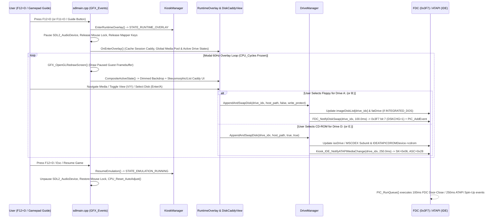

# Phase 4 Implementation Plan: Skeuomorphic Media Caddy & Runtime Disk-Swap Overlay

**Project:** DOSBox-X Kiosk Edition  
**Target Firmware Host:** Buildroot Linux Appliance (`BR2_PACKAGE_DOSBOX_X_KIOSK=y`) & Desktop Big-Picture Mode  
**Development & Verification Platform:** Windows 10/11 (Visual Studio 2022/MSBuild, SDL2 x64) + Linux Autotools (`configure.ac` / `Makefile.am`)  
**Document Status:** Detailed Phase Execution Plan  
**Date:** November 19, 2026  
**Feature Branch:** `feat/kiosk-phase-4` (branched directly from `master` after Phase 3 merge)  
**Reference Documents:**
- [`docs/Kiosk/DOSBox-X_Kiosk_Implementation_Plan.md`](./DOSBox-X_Kiosk_Implementation_Plan.md#L192-L212)
- [`docs/Kiosk/DOSBox-X Kiosk Launcher Design.md`](./DOSBox-X%20Kiosk%20Launcher%20Design.md#L108-L152)
- [`docs/Kiosk/DOSBox-X Kiosk Launcher Design.md` (Section 3 & 4: Skeuomorphic Renderer & Runtime Overlay)](./DOSBox-X%20Kiosk%20Launcher%20Design.md#L1566-L1651)
- [`docs/Kiosk/Phase3_Ephemeral_Boot_Injector_Plan.md`](./Phase3_Ephemeral_Boot_Injector_Plan.md)

---

## 1. Objective & Scope of Phase 4

Phase 4 delivers the **Skeuomorphic Media Caddy & Runtime Disk-Swap Overlay (`STATE_RUNTIME_OVERLAY`)**, enabling visual, zero-context-switch floppy disk (`A:`, `B:`) and optical CD-ROM (`D:`, `E:`) swapping during live emulation via `F12+D` (or the `F11+O` alias / controller Guide button) without breaking fullscreen KMSDRM/OpenGL rendering or corrupting guest OS filesystem caches.

Specifically, Phase 4 implements:
1. **Hotkey Interception & Audio-Safe Emulation Freeze (`src/gui/sdlmain.cpp` & `src/kiosk/ui/runtime_overlay.h/.cpp`):**
   - Intercepts `F12+D`, `F11+O`, configurable `kiosk_config.overlay_hotkey`, and `SDL_CONTROLLER_BUTTON_GUIDE` inside `GFX_Events()`.
   - Pauses CPU execution and audio output cleanly (`SDL_PauseAudioDevice` + mixer silence guard to prevent DMA ring-buffer buzz), saves and releases relative mouse lock (`sdl.mouse.locked`), preserves the active guest VGA/SVGA/3dfx OpenGL texture as a dimmed backdrop, and runs the 60 Hz interactive overlay loop.
   - Supports instant keyboard and gamepad navigation: `V` / `F2` / Gamepad `Y` toggles between **Skeuomorphic Shelf View** and **Compact List View** (`CaddyViewMode`), `Enter` / Gamepad `A` hot-swaps the highlighted disk into its target drive, `F12+D` / `Esc` / Gamepad `B` / `Guide` resumes emulation, and dedicated action buttons allow ejecting drives, toggling floppy write protection, adjusting Redbook CD-Audio volume, sending `Ctrl+Alt+Del` warm reboot, or returning cleanly to the Kiosk Hub (`USER_OVERLAY_ABORT`).
2. **Media Header Inspector & Procedural Skeuomorphic Renderer (`src/kiosk/ui/view_disk_caddy.h/.cpp`):**
   - Inspects disk image headers and geometry to auto-detect media type (`FLOPPY_525_360K`, `FLOPPY_525_1200K`, `FLOPPY_35_720K`, `FLOPPY_35_1440K`, `FLOPPY_35_2880K`, `CDROM_ISO`, `CDROM_CUE`), extract FAT12/16 BPB (`0x2B`) or root-directory volume labels and ISO9660 Primary Volume Descriptor (`0x8028`) labels, and detect Redbook audio tracks in `.cue` sheets.
   - Procedurally renders resolution-independent 5.25" flexible diskettes (`CHARCOAL_525`), 3.5" microfloppies (`BEIGE_35`, `BLUE_35`, `BLACK_35` with deterministic hash-based variety and $\pm 0.8^\circ$ sticker jitter), and CD-ROM jewel cases (`JEWEL_CD`, `GOLD_CD` with polycarbonate highlight and Redbook audio note badge) using Dear ImGui vector draw lists (`ImDrawList`).
3. **Direct Hardware Remounting & Guest Bus Signaling (`src/dos/drives.h/.cpp`, `src/hardware/floppy.cpp`, `src/hardware/ide.cpp`):**
   - Implements `DriveManager::AppendAndSwapDisk()` so users can both switch among pre-queued session caddy disks and dynamically insert any floppy or CD-ROM from the Global Media Pool or removable USB storage at runtime—even if the image was not listed on the boot-time `IMGMOUNT` command line.
   - **Floppy Controller (`0x3F7` `DSKCHG`) & 100ms Door-Open Protocol:** Fixes per-drive `imageDiskChange[devidx]` indexing on port `0x3F7` bit 7 (`0x80`) in `src/hardware/floppy.cpp` and holds the virtual floppy drive door open for `100ms` of emulated CPU time via `PIC_AddEvent`, forcing MS-DOS and Windows 9x to invalidate cached FAT tables before latching the new floppy image.
   - **ATAPI CD-ROM Unit Attention (`SK=0x06, ASC=0x28, ASCQ=0x00`) Protocol:** Signals a 250ms virtual tray eject/insert cycle on the target ATAPI CD-ROM device (`D:` / `E:`) and reports standard SCSI/ATAPI `UNIT ATTENTION` (`SK=0x06, ASC=0x28, ASCQ=0x00` — `NOT READY TO READY TRANSITION, MEDIUM MAY HAVE CHANGED`), prompting both `MSCDEX.EXE` in DOS and `CDFS.VXD` (AutoPlay) in Windows 95/98 to re-read the directory and Redbook audio TOC.

---

## 2. Key Architectural Refinements & Upstream Findings

> [!IMPORTANT]
> **Per-Drive `0x3F7` Disk-Change Bit (`DSKCHG`) & Write-Protection in `src/hardware/floppy.cpp`**:
> 1. **Upstream Indexing Fix (`interface_index` vs `devidx`)**: In upstream [`src/hardware/floppy.cpp`](../../src/hardware/floppy.cpp#L1604), reading Digital Input Register `0x3F7` (`case 7:`) and clearing disk change on Calibrate/Seek (`case 0x07:`, `case 0x0F:`) checked `imageDiskChange[fdc->interface_index]` (which is always controller `0`, marked with `//FIXME` in upstream). Because `FloppyController` `0` manages both Drive A (`device[0]`, `int13_disk = 0`) and Drive B (`device[1]`, `int13_disk = 1`), Phase 4 resolves the active drive index via `devidx = fdc->drive_selected() & 3` (and `dev->int13_disk`) so `0x3F7` bit 7 accurately reflects disk changes on both `A:` and `B:`.
> 2. **100ms Emulated Door-Open Hold (`PIC_AddEvent`)**: While the runtime overlay is open, emulated CPU cycles and `PIC_RunQueue()` are paused. When the user selects a new floppy and resumes emulation, `FDC_NotifyDiskSwap(drive_idx, 100.0)` holds a per-drive `fdc_door_open[drive_idx]` flag true for `100.0ms` of *emulated* CPU time via `PIC_AddEvent(FDC_DoorCloseEvent, 100.0, drive_idx)`. During that 100ms window, any FDC read/write/read-ID or `INT 13h` poll sees `0x3F7` bit 7 (`0x80`) high and receives Drive Not Ready / Disk Changed (`ST[0] = 0x48 | devidx`, `Int13Status::DiskChanged`), preventing step pulses from prematurely clearing `DSKCHG` before the new disk latches.
> 3. **Runtime Write-Protect Toggle**: In addition to DOSBox-X's `:path` prefix, Phase 4 adds a per-drive runtime write-protect flag (`FDC_SetWriteProtected(drive_idx, bool)` / `imageDisk::isWriteProtected`) checked by `imageDisk::Write_AbsoluteSector()` (returning `Int13Status::WriteProtected = 0x03`) and FDC Write Data `case 0x05`/`0x09` + Check Drive Status `ST[3]` bit 6 (`0x40`).

> [!IMPORTANT]
> **ATAPI Sense Key `0x06` (`UNIT ATTENTION`) & `TEST UNIT READY` Handling in `src/hardware/ide.cpp`**:
> In upstream [`src/hardware/ide.cpp`](../../src/hardware/ide.cpp#L523-L529), `common_spinup_response()` in `case LOAD_DISC_READIED:` transitions `loading_mode = LOAD_READY` and calls `set_sense(/*SK=*/0x02, /*ASC=*/0x28, /*ASCQ=*/0x00)`, and only clears `has_changed = false` if `trigger == true`. However:
> - Per the SCSI-2 / ATAPI SFF-8020i specification, `ASC = 0x28, ASCQ = 0x00` (`NOT READY TO READY TRANSITION, MEDIUM MAY HAVE CHANGED`) belongs to **Sense Key `0x06` (`UNIT ATTENTION`)**, not `0x02` (`NOT READY`).
> - Windows 95/98 `CDFS.VXD` polls for disc insertion using `TEST UNIT READY` (`0x00`), which calls `common_spinup_response(/*trigger=*/false, /*wait=*/false)`.
> - In Phase 4, `Kiosk_IDE_NotifyATAPIMediaChange(drive_index, 250.0)` schedules a 250ms virtual tray cycle (`125ms` `LOAD_INSERT_CD` with `SK=0x02, ASC=0x3A` -> `125ms` `LOAD_DISC_LOADING` -> `LOAD_DISC_READIED` with `has_changed = true`), and in `LOAD_DISC_READIED` (when `C_KIOSK` is active) reports `set_sense(/*SK=*/0x06, /*ASC=*/0x28, /*ASCQ=*/0x00)` and clears `has_changed = false` once reported so `TEST UNIT READY` receives the Unit Attention transition cleanly and immediately succeeds on the next poll.

> [!NOTE]
> **Drive `B:` Ephemeral Dispatch Protection During `REAL_HDD_BOOT` Item Sessions**:
> Recall from Phase 3 that when a `CatalogItemRecord` is launched on a `REAL_HDD_BOOT` machine (Mode A), Floppy Drive `B:` (`IMGMOUNT 1`) is reserved for `kiosk_dispatch.img` (`B:\KIOSKGO.BAT` + `B:\KIOSKEXT.COM`) so the post-exit shutdown utility is always available when the game exits. In the Runtime Overlay, when `KioskManager::GetInstance().GetActiveDispatchImagePath()` is mounted on `B:` during an active item launch, Drive `B:` is displayed with a `[SYSTEM DISPATCH - LOCKED]` badge (or hidden from user swap targets, with all user floppies routed to Drive `A:`), while Machine-Only boots (Mode B) or `INTEGRATED_DOS` sessions allow full user swapping on both `A:` and `B:`.

---

## 3. Architecture & Execution Flow

### 3.1 Runtime Overlay & Hot-Swap Sequence



### 3.2 Procedural Skeuomorphic Media Rendering Layers

```mermaid
flowchart LR
    subgraph Inspector["1. Media Header Inspector"]
        File["Disk Image (.img/.ima/.iso/.cue)"] --> Geo["Size & Geometry Sniffer\n(360K/1.2M 5.25\", 720K/1.44M/2.88M 3.5\", ISO/CUE)"]
        File --> Vol["Volume Label Extractor\n(FAT BPB 0x2B / Root 0x08 / ISO9660 PVD 0x8028)"]
        File --> Audio["CUE Sheet Audio Detector\n(TRACK 02 AUDIO -> Redbook Badge)"]
    end

    subgraph Layers["2. Multi-Layer ImDrawList Renderer (view_disk_caddy.cpp)"]
        L1["Layer 1: Base Shell\n- 5.25\" Charcoal Jacket\n- 3.5\" Beige / Cobalt Blue / Matte Black\n- Polycarbonate Jewel Case"]
        L2["Layer 2: Hardware Details\n- 5.25\" Hub Ring, Index Hole, Head Slot, WP Notch\n- 3.5\" Brushed Metal Shutter & WP Window\n- CD Iridescent Data Ring & Spindle Hub"]
        L3["Layer 3: Paper Sticker Decal\n- Aged Cream 9-Slice Label\n- Era-Colored Header Stripe\n- Deterministic ±0.8° Angle Offset"]
        L4["Layer 4: Dynamic Typography & Badges\n- DOT_MATRIX / HANDWRITTEN / PRINTED_OEM\n- Title, Subtitle & Volume Label\n- Active Drive Glow & Redbook Note ♫"]
        L1 --> L2 --> L3 --> L4
    end

    Inspector --> Layers
```

---

## 4. Proposed Changes by Component

### Component 1: Procedural Skeuomorphic Media Caddy & Header Inspector

Create `src/kiosk/ui/view_disk_caddy.h` and `src/kiosk/ui/view_disk_caddy.cpp` to provide both the non-destructive disk header/label inspector and the Dear ImGui procedural skeuomorphic media card renderer (used by both the Phase 4 Runtime Overlay and the Phase 5 Pre-Boot Media Pool Manager).

#### [NEW] [`src/kiosk/ui/view_disk_caddy.h`](../../src/kiosk/ui/view_disk_caddy.h)
#### [NEW] [`src/kiosk/ui/view_disk_caddy.cpp`](../../src/kiosk/ui/view_disk_caddy.cpp)

```cpp
#ifndef DOSBOX_KIOSK_VIEW_DISK_CADDY_H
#define DOSBOX_KIOSK_VIEW_DISK_CADDY_H

#include "../kiosk_types.h"
#include <string>
#include <vector>
#include <cstdint>

struct ImDrawList;

struct InspectedMediaInfo {
    std::string media_type = "FLOPPY_35_1440K";     // MediaType string
    std::string physical_style = "BEIGE_35";        // MediaPhysicalStyle string
    std::string volume_label;                       // Extracted from FAT BPB/Root or ISO9660 PVD
    std::string label_title;                        // Derived or explicit line 1
    std::string label_subtitle;                     // Derived geometry description (e.g., "3.5\" 1.44MB HD")
    bool has_redbook_audio = false;                 // True if CUE sheet contains AUDIO tracks
    uint64_t file_size_bytes = 0;
};

struct DiskCardRenderParams {
    MediaPoolRecord media;
    std::string target_drive = "A";                 // "A", "B", "D", "E"
    int slot_order = 1;
    bool is_mounted_active = false;                 // True if currently inserted in target_drive
    bool is_selected_focused = false;               // True if highlighted by keyboard/gamepad cursor
    float card_width = 168.0f;
    float card_height = 188.0f;
};

class DiskCaddyView {
public:
    static DiskCaddyView& GetInstance();

    // 1. Deterministic CRC32 & Visual Variety Helpers
    static uint32_t ComputeCrc32(const void* data, size_t length);
    static uint32_t ComputeStringCrc32(const std::string& str);

    // Deterministically resolves physical style ("CHARCOAL_525", "BEIGE_35", "BLUE_35", "BLACK_35", "JEWEL_CD", "GOLD_CD")
    // When a 3.5" floppy uses default/auto style, hashes id/path (CRC32 % 3) across Beige, Blue, and Black.
    static std::string ResolvePhysicalStyle(
        const std::string& media_type,
        const std::string& explicit_style,
        const std::string& seed_id_or_path
    );

    // Deterministic sticker rotation jitter in degrees within [-0.8f, +0.8f]
    static float ComputeStickerAngleJitterDeg(const std::string& seed_id_or_path);

    // 2. Non-Destructive Media Header & Volume Label Inspector
    // Inspects file size, FAT12/16 BPB (0x2B) / root volume entry, ISO9660 PVD (0x8028), or CUE sheet
    static bool InspectMediaFile(const std::string& file_path, InspectedMediaInfo& out_info);
    static bool ExtractFatVolumeLabelFromBytes(const uint8_t* data, size_t size, std::string& out_label);
    static bool ExtractIso9660VolumeLabelFromFile(const std::string& file_path, std::string& out_label);
    static bool DetectCueSheetRedbookAudio(const std::string& cue_path, std::string& out_first_bin_path);
    static std::string HumanReadableMediaTypeBadge(const std::string& media_type);

    // 3. ImGui Procedural Skeuomorphic Card Renderer
    // Returns true if the card was clicked/activated by the user in the current frame.
    bool RenderMediaCard(const DiskCardRenderParams& params);

private:
    DiskCaddyView() = default;

    void DrawFloppy525(ImDrawList* draw_list, float x, float y, float w, float h, const DiskCardRenderParams& params, uint32_t seed_hash);
    void DrawFloppy35(ImDrawList* draw_list, float x, float y, float w, float h, const DiskCardRenderParams& params, uint32_t seed_hash);
    void DrawCdJewelCase(ImDrawList* draw_list, float x, float y, float w, float h, const DiskCardRenderParams& params, uint32_t seed_hash);
    void DrawStickerTypography(ImDrawList* draw_list, float lx, float ly, float lw, float lh, const DiskCardRenderParams& params, uint32_t seed_hash);
};

#endif // DOSBOX_KIOSK_VIEW_DISK_CADDY_H
```

##### Key Implementation Details in `view_disk_caddy.cpp`:
1. **`InspectMediaFile(file_path, out_info)`**:
   - Extracts extension (`.img`, `.ima`, `.vfd`, `.iso`, `.cue`, `.bin`) case-insensitively and derives a clean default `label_title` from the filename stem if none is stored in the database.
   - **For `.cue` files**: Parses text lines via `DetectCueSheetRedbookAudio()` to detect `TRACK <N> AUDIO` (`out_info.has_redbook_audio = true`), resolves the primary `FILE "<bin>" BINARY` data track in the same directory, and extracts the ISO9660 Primary Volume Descriptor (`\x01CD001` at sector 16 — byte offset `16 * 2048 = 0x8000` for 2048-byte sectors or `16 * 2352 + 16 = 0x9310` for raw 2352-byte Mode 1 sectors, reading the 32-byte Volume Identifier at `+40` / `0x8028`). Sets `media_type = "CDROM_CUE"` and `physical_style = "JEWEL_CD"`.
   - **For `.iso` files**: Reads sector 16 (`0x8000`), verifies `\x01CD001`, extracts the 32-byte trimmed ASCII volume label at `0x8028`, sets `media_type = "CDROM_ISO"` and `physical_style = "JEWEL_CD"`.
   - **For Floppy Images (`.img`, `.ima`, `.vfd`)**:
     - Maps file byte size to canonical floppy media types:
       - $\le 368,640$ bytes (360 KB) $\rightarrow$ `FLOPPY_525_360K`, `CHARCOAL_525`, subtitle `"5.25\" 360KB DD"`.
       - $737,280$ bytes (720 KB) $\rightarrow$ `FLOPPY_35_720K`, `BEIGE_35`, subtitle `"3.5\" 720KB DD"`.
       - $1,228,800$ bytes (1.2 MB) $\rightarrow$ `FLOPPY_525_1200K`, `CHARCOAL_525`, subtitle `"5.25\" 1.2MB HD"`.
       - $1,474,560$ bytes (1.44 MB) $\rightarrow$ `FLOPPY_35_1440K`, `BEIGE_35`, subtitle `"3.5\" 1.44MB HD"`.
       - $2,949,120$ bytes (2.88 MB) $\rightarrow$ `FLOPPY_35_2880K`, `BLACK_35`, subtitle `"3.5\" 2.88MB ED"`.
     - Calls `ExtractFatVolumeLabelFromBytes()` on the first 64 KB of the image: checks the root directory for an entry with `DIR_Attr == 0x08` (Volume ID) first, and falls back to BPB extended boot signature `0x28`/`0x29` at offset `0x26` with the 11-byte `BPB_VolLab` at offset `0x2B` (ignoring `"NO NAME    "`).
2. **Multi-Layer ImDrawList Rendering (`DrawFloppy525`, `DrawFloppy35`, `DrawCdJewelCase`, `DrawStickerTypography`)**:
   - Uses `ImGui::InvisibleButton` for full keyboard/gamepad/mouse focus and hit-testing, and renders all vector geometry directly onto `ImGui::GetWindowDrawList()` with zero external PNG asset dependencies.
   - **5.25" Diskette (`DrawFloppy525`)**: Charcoal outer sleeve (`#242629`) with rounded corners, center drive hub hole (`r = 18%` of width) with dark reinforcing hub ring, small index timing hole to the lower-right of the hub, lower vertical oval head-access window showing dark brown magnetic media (`#3B271E`), right-edge rectangular write-protect notch (covered by a metallic silver tab when `is_write_protected == true`), and top paper sticker decal.
   - **3.5" Microfloppy (`DrawFloppy35`)**: Shell color determined by `ResolvePhysicalStyle` (`BEIGE_35` `#D8D2C1`, `BLUE_35` `#24549C`, `BLACK_35` `#22252A`), chamfered top-right corner triangle, top-center recessed area with brushed-metal sliding shutter (`#B8BEC6`) and rectangular media window cutout, bottom-left write-protect indicator hole (open red/hollow when write-protected, closed dark tab when writable), and recessed bottom paper label with era-striped header bar and subtle deterministic angle jitter offset.
   - **CD-ROM Jewel Case (`DrawCdJewelCase`)**: Ribbed dark charcoal spine on the left (`12%` width), crystal-clear polycarbonate outer frame (`#DCE6F0` border + diagonal specular reflection polygon), circular disc rendered inside (`JEWEL_CD` silver-cyan iridescent rings or `GOLD_CD` archival gold rings) with transparent center spindle clamping ring, lower-right booklet label card, and a pulsing gold/cyan musical note badge (`[AUDIO]`) if `has_redbook_audio == true`.

---

### Component 2: Direct Hardware Remounting & Guest Bus Signaling

Extend `DriveManager` (`src/dos/drives.h`, `src/dos/drives.cpp`), `FloppyController` (`src/hardware/floppy.cpp`, `include/bios_disk.h`, `src/ints/bios_disk.cpp`), and `IDEATAPICDROMDevice` (`src/hardware/ide.cpp`, `include/ide.h`) with `#if defined(C_KIOSK)` guarded runtime hot-swap APIs.

#### [MODIFY] [`src/dos/drives.h`](../../src/dos/drives.h) & [`src/dos/drives.cpp`](../../src/dos/drives.cpp)

Add Kiosk runtime inspection and dynamic disk hot-swap methods to `DriveManager`:

```cpp
#if defined(C_KIOSK)
    // Returns number of disks in DriveManager for 'A'+drive, or 1 if an unmanaged BIOS disk is in imageDiskList
    static int GetKioskSlotCount(int drive);
    static int GetKioskCurrentSlot(int drive);
    static std::string GetKioskActiveDiskPath(int drive);
    static std::vector<std::string> GetKioskDrivePaths(int drive);

    // Dynamically appends host_path to the drive's swap list (if not already present)
    // and performs a live hot-swap (updating Drives[drive], imageDiskList[drive], FDC 0x3F7, or ATAPI Sense).
    static bool AppendAndSwapDisk(int drive, const std::string& host_path, bool is_cdrom, bool write_protected = false);

    // Ejects the currently mounted floppy (A:/B:) or CD-ROM (D:/E:) without terminating the session
    static bool EjectDriveMedia(int drive, bool is_cdrom);
#endif
```

##### How `DriveManager::AppendAndSwapDisk()` Handles Every Boot Mode:
1. **Floppy Drives (`drive == 0` for `A:`, `drive == 1` for `B:`)**:
   - **Case 1A (`INTEGRATED_DOS` mode, `!dos_kernel_disabled`)**:
     - Scans `driveInfos[drive].disks` for an existing `fatDrive*` whose `loadedDisk->diskname` (or base info path) matches `host_path`.
     - If found at index `idx`: calls `DriveManager::CycleDisks(drive, true, false, idx + 1)`, `Drives[drive]->EmptyCache()`, and `Drives[drive]->MediaChange()`.
     - If not found (or if Drive `A:`/`B:` had no disk mounted at boot): opens `host_path` (respecting `write_protected` or read-only fallback), constructs `new fatDrive(...)`, appends it via `DriveManager::AppendDisk(drive, new_fat_drive)`, initializes or switches `driveInfos[drive].currentDisk` to the new slot, updates `Drives[drive]`, and updates `imageDiskList[drive]` + `updateFloppyDPT()` + `FDC_AssignINT13Disk(drive)`.
   - **Case 1B (`REAL_HDD_BOOT` mode, `dos_kernel_disabled` / `-fs none`)**:
     - Scans `diskSwap[0..MAX_SWAPPABLE_DISKS-1]` (when `swapInDisksSpecificDrive == drive`) for an `imageDisk*` matching `host_path`.
     - If not already in `diskSwap`, opens `FILE*` (read-only if `write_protected == true`, else `"rb+"` with `"rb"` fallback), auto-detects geometry from file size in KB (`imgSize / 1024`), constructs `new imageDisk(imgFile, host_path.c_str(), imgSizeK, false)`, and inserts it into the first free `diskSwap` slot.
     - Replaces `imageDiskList[drive]` (releasing previous reference, `Addref()` on new `imageDisk*`), updates BIOS Floppy DPT (`updateFloppyDPT()`), ensures `FDC_AssignINT13Disk(drive)` is bound, and invokes `FDC_NotifyDiskSwap(drive, 100.0, write_protected)`.
2. **Optical CD-ROM Drives (`drive >= 2`, typically `3` for `D:` and `4` for `E:`)**:
   - If `driveInfos[drive].disks` already contains `isoDrive*` entries:
     - Checks if `host_path` matches one of the existing `isoDrive` slots (`idx`).
     - If found: switches `driveInfos[drive].currentDisk = idx`, updates `Drives[drive]`, calls `Drives[drive]->Activate()` (which calls `MSCDEX_UpdateDrive` and `UpdateCDROMRef()`), calls `Drives[drive]->EmptyCache()`, and triggers `Kiosk_IDE_NotifyATAPIMediaChange(drive, 250.0)`.
     - If not found in `driveInfos[drive].disks`:
       - When `MSCDEX_HasDrive('A' + drive)` is true (mounted at boot before `BOOT -l c` or in `INTEGRATED_DOS`): constructs `new isoDrive('A' + drive, host_path.c_str(), 0xF8, error, options)` (which calls `MSCDEX_UpdateDrive` on the existing subunit without allocating a new drive letter!), appends it to `driveInfos[drive].disks`, sets `currentDisk` to the new index, updates `Drives[drive]`, calls `Activate()` + `EmptyCache()`, and calls `Kiosk_IDE_NotifyATAPIMediaChange(drive, 250.0)`.
       - When `Drives[drive]` was not mounted prior to boot: if `!dos_kernel_disabled`, mounts and attaches the new `isoDrive` to Secondary IDE (`IDE_CDROM_Attach`); if `dos_kernel_disabled`, checks if an `IDEATAPICDROMDevice` exists on Secondary IDE and replaces its `CDROM_Interface*` via `CDROM_AllocateInterface(host_path.c_str(), ...)` + `Kiosk_IDE_NotifyATAPIMediaChange()`.

#### [MODIFY] [`include/bios_disk.h`](../../include/bios_disk.h), [`src/ints/bios_disk.cpp`](../../src/ints/bios_disk.cpp) & [`src/hardware/floppy.cpp`](../../src/hardware/floppy.cpp)

1. **Runtime Write-Protection & Door-Open State on `imageDisk` / FDC**:
   - In `include/bios_disk.h`, add `bool write_protected = false;` to `imageDisk` (or check it in `imageDisk::Write_AbsoluteSector()` to return `Int13Status::WriteProtected` when `write_protected == true`).
   - Declare Kiosk FDC helpers in `include/bios_disk.h` (under `#if defined(C_KIOSK)`):
     ```cpp
     #if defined(C_KIOSK)
     void FDC_NotifyDiskSwap(int drive_idx, double door_open_ms = 100.0, bool write_protected = false);
     void FDC_NotifyDiskEject(int drive_idx);
     bool FDC_IsDoorOpen(int drive_idx);
     void FDC_SetWriteProtected(int drive_idx, bool write_protected);
     bool FDC_IsWriteProtected(int drive_idx);
     uint8_t FDC_DebugReadDIR(int drive_idx);
     #endif
     ```
2. **Per-Drive `0x3F7` `DSKCHG` & 100ms Door-Open Timer in `src/hardware/floppy.cpp`**:
   - Track `static bool fdc_kiosk_door_open[4] = {false, false, false, false};` and `static bool fdc_kiosk_write_protect[4] = {false, false, false, false};`.
   - Implement `FDC_KioskCloseDoorEvent(Bitu drive_idx)`:
     ```cpp
     static void FDC_KioskCloseDoorEvent(Bitu drive_idx) {
         if (drive_idx < 4) {
             fdc_kiosk_door_open[drive_idx] = false;
             if (drive_idx < MAX_DISK_IMAGES) {
                 imageDiskChange[drive_idx] = true; // Latch DSKCHG high until next step pulse
             }
             LOG_MSG("KIOSK FDC: Drive %c: virtual door closed after swap; DSKCHG latched.", 'A' + (int)drive_idx);
         }
     }
     ```
   - In `fdc_baseio_r` `case 7:` (`0x3F7` Digital Input Register):
     - Resolve selected drive `int devidx = fdc->drive_selected() & 3;`.
     - Set bit 7 (`b |= 0x80`) when `(devidx < MAX_DISK_IMAGES && imageDiskChange[devidx]) || fdc_kiosk_door_open[devidx] || (fdc->device[devidx] == NULL || fdc->device[devidx]->getImage() == NULL)`.
   - In `on_fdc_in_command()` `case 0x07:` (Calibrate) and `case 0x0F:` (Seek Head):
     - Only clear `imageDiskChange[devidx] = false` when `!fdc_kiosk_door_open[devidx]` (so step pulses during the 100ms door-open window cannot prematurely clear `DSKCHG`!).
   - In `on_fdc_in_command()` `case 0x05:` / `case 0x09:` (Write Data) and `update_ST3()`:
     - If `fdc_kiosk_write_protect[devidx]` (or `img->write_protected`), set `ST[3] |= 0x40` (Write Protect) and reject writes with `ST[0] = (ST[0] & 0x1F) | 0x40` (Abnormal Termination) and `ST[1] = 0x02` (Not Writeable).

#### [MODIFY] [`include/ide.h`](../../include/ide.h) & [`src/hardware/ide.cpp`](../../src/hardware/ide.cpp)

Declare and implement Kiosk ATAPI media-change & sense helpers (under `#if defined(C_KIOSK)`):

```cpp
#if defined(C_KIOSK)
bool Kiosk_IDE_NotifyATAPIMediaChange(unsigned char drive_index, double tray_delay_ms = 250.0);
bool Kiosk_IDE_EjectATAPIMedia(unsigned char drive_index);
bool Kiosk_IDE_GetATAPISense(unsigned char drive_index, uint8_t& out_sk, uint8_t& out_asc, uint8_t& out_ascq, int& out_loading_mode);
#endif
```

- **`Kiosk_IDE_NotifyATAPIMediaChange(drive_index, tray_delay_ms)`**:
  - Finds the `IDEATAPICDROMDevice*` matching `drive_index` (or Secondary IDE Master when `drive_index == 3` / `'D' - 'A'`).
  - Refreshes `atapi->cdrom` from `GetMSCDEXDrive(drive_index, &cdrom)` when `atapi->mscdex == true`.
  - Sets `atapi->has_changed = true`.
  - If `tray_delay_ms <= 0.0`, transitions directly to `atapi->loading_mode = LOAD_DISC_READIED` and sets sense `SK = 0x06` (`UNIT ATTENTION`), `ASC = 0x28`, `ASCQ = 0x00` (`NOT READY TO READY TRANSITION, MEDIUM MAY HAVE CHANGED`).
  - If `tray_delay_ms > 0.0`, sets `atapi->loading_mode = LOAD_INSERT_CD`, temporarily sets `atapi->cd_insertion_time = tray_delay_ms * 0.5` and `atapi->spinup_time = tray_delay_ms * 0.5`, and schedules `PIC_AddEvent(IDE_ATAPI_CDInsertion, atapi->cd_insertion_time, pk)` so any guest poll during the first 250ms sees `Medium Not Present` / `Becoming Ready` followed by `LOAD_DISC_READIED` (`SK=0x06, ASC=0x28, ASCQ=0x00`).
- **In `IDEATAPICDROMDevice::common_spinup_response()` (`case LOAD_DISC_READIED:`)**:
  - Under `#if defined(C_KIOSK)`, use Sense Key `0x06` (`UNIT ATTENTION`) with `ASC = 0x28, ASCQ = 0x00` and clear `has_changed = false` so `TEST UNIT READY` (`trigger == false`) signals the media transition once and transitions cleanly to `LOAD_READY`.

---

### Component 3: Runtime Disk-Swap Overlay Controller & UI (`src/kiosk/ui/runtime_overlay.h/.cpp`)

Create a dedicated `RuntimeOverlay` singleton in `src/kiosk/ui/runtime_overlay.h` and `src/kiosk/ui/runtime_overlay.cpp` to manage the cached session caddy state, drive status bars, view-mode toggling (`SKEUOMORPHIC` vs `LIST`), CD-Audio mixer volume control, and hot-swap execution without querying SQLite on the 60 Hz render thread.

#### [NEW] [`src/kiosk/ui/runtime_overlay.h`](../../src/kiosk/ui/runtime_overlay.h)
#### [NEW] [`src/kiosk/ui/runtime_overlay.cpp`](../../src/kiosk/ui/runtime_overlay.cpp)

```cpp
#ifndef DOSBOX_KIOSK_RUNTIME_OVERLAY_H
#define DOSBOX_KIOSK_RUNTIME_OVERLAY_H

#include "../kiosk_types.h"
#include "view_disk_caddy.h"
#include <string>
#include <vector>

typedef union SDL_Event SDL_Event;

struct RuntimeDriveSlotStatus {
    std::string drive_letter;       // "A", "B", "D", "E"
    int drive_index = 0;            // 0=A, 1=B, 3=D, 4=E
    bool is_optical = false;        // false=Floppy, true=ATAPI CD-ROM
    bool is_mounted = false;
    bool is_write_protected = false;
    bool is_dispatch_reserved = false; // True for B: during REAL_HDD_BOOT item launch
    std::string active_file_path;
    std::string active_label;
    std::string media_type_badge;
    int current_slot_index = 0;
    int total_slots = 0;
};

struct RuntimeCaddyEntry {
    CaddyBindingRecord binding;
    MediaPoolRecord media;
    bool is_from_global_pool = false;
};

class RuntimeOverlay {
public:
    static RuntimeOverlay& GetInstance();

    // Called once when entering STATE_RUNTIME_OVERLAY to snapshot DB caddy,
    // global media pool, and active drive states (Zero per-frame SQLite queries)
    void OnEnterOverlay();
    void RefreshDriveStatuses();

    // Renders the dimmed background and full Runtime Media Caddy modal window
    void Render();

    // Handles overlay-specific keyboard/gamepad shortcuts (V/F2/Y view toggle, etc.)
    bool HandleInputEvent(const SDL_Event& event);

    // View mode (SKEUOMORPHIC vs LIST)
    CaddyViewMode GetViewMode() const { return m_view_mode; }
    void SetViewMode(CaddyViewMode mode) { m_view_mode = mode; }
    void ToggleViewMode();

    // Programmatic hot-swap, eject, write-protect & audio controls (also used by unit tests)
    bool PerformHotSwap(const std::string& target_drive, const std::string& host_path, bool write_protected = false);
    bool PerformHotSwapCaddySlot(size_t caddy_index);
    bool EjectDrive(const std::string& target_drive);
    bool ToggleDriveWriteProtect(const std::string& target_drive);

    float GetCdAudioVolumePercent() const { return m_cd_volume_percent; }
    void SetCdAudioVolumePercent(float percent);

    const std::vector<RuntimeDriveSlotStatus>& GetDriveStatuses() const { return m_drive_statuses; }
    const std::vector<RuntimeCaddyEntry>& GetSessionCaddy() const { return m_session_caddy; }
    const std::string& GetLastStatusMessage() const { return m_status_message; }

private:
    RuntimeOverlay() = default;

    void RenderHeaderBar();
    void RenderActiveDriveSlots();
    void RenderSkeuomorphicShelf();
    void RenderCompactListView();
    void RenderGlobalMediaPoolDrawer();
    void RenderFooterBar();

    CaddyViewMode m_view_mode = CaddyViewMode::SKEUOMORPHIC;
    std::vector<RuntimeDriveSlotStatus> m_drive_statuses;
    std::vector<RuntimeCaddyEntry> m_session_caddy;
    std::vector<MediaPoolRecord> m_global_pool_cache;
    bool m_show_global_pool_drawer = false;
    int m_selected_caddy_index = 0;
    float m_cd_volume_percent = 100.0f;
    std::string m_active_machine_name;
    std::string m_active_item_title;
    std::string m_status_message;
};

#endif // DOSBOX_KIOSK_RUNTIME_OVERLAY_H
```

##### Key Implementation Details in `runtime_overlay.cpp`:
1. **Zero Per-Frame SQLite Queries (`OnEnterOverlay`)**:
   - Reads `KioskManager::GetInstance().GetConfig()` once to set the initial `m_view_mode` (`default_caddy_view == "LIST"` $\rightarrow$ `CaddyViewMode::LIST`, else `CaddyViewMode::SKEUOMORPHIC`).
   - Resolves the current `LaunchContext` from `KioskManager::GetInstance().GetCurrentLaunchContext()`, loads the `MachineRecord`, `CatalogItemRecord`, `GetCaddyBindingsForItem()` / `GetCaddyBindingsForMachine()`, and `GetAllMedia()` from `KioskDatabase` once, and enriches each entry with `DiskCaddyView::InspectMediaFile()` if `volume_label` or `label_title` is empty.
   - Also inspects currently mounted DOSBox-X drives (`A:`, `B:`, `D:`, `E:`) via `DriveManager::GetKioskDrivePaths()`; if any disk was mounted via CLI/autoexec that isn't in `m_session_caddy`, synthesizes a `RuntimeCaddyEntry` for it so it still appears as a visual disk in the caddy!
2. **Active Drive Slots Panel (`RenderActiveDriveSlots`)**:
   - Displays side-by-side status cards for **Drive A: (Floppy)**, **Drive B: (Floppy / Dispatch)**, and **Drive D: (ATAPI CD-ROM)** (plus **Drive E:** if mounted).
   - For Floppy drives: shows mounted filename & volume label, `[Eject Door]` button, and `[Write Protect: ON/OFF]` toggle button (disabled on `B:` if reserved for `kiosk_dispatch.img`).
   - For Optical CD-ROM drives: shows mounted ISO/CUE filename & volume label, `[Eject Tray]` button, and a live `CD Volume` slider (`0%..100%`) wired to `MIXER_FindChannel("CDAUDIO")->SetScale(vol, vol)`.
3. **Dual-Mode Session Caddy (`RenderSkeuomorphicShelf` & `RenderCompactListView`)**:
   - **Skeuomorphic Shelf Mode**: Renders horizontal rows of procedural 5.25", 3.5", and CD-ROM jewel case cards via `DiskCaddyView::GetInstance().RenderMediaCard()`, with an `* IN DRIVE A: *` / `* IN DRIVE D: *` highlight border on currently active disks and `Enter` / `Click` / Gamepad `A` to hot-swap immediately.
   - **Compact List Mode**: Renders a keyboard/gamepad-navigable ImGui table (`Slot | Drive | Type | Title | Volume Label | File | Status | Action`) for rapid filtering across large multi-disk sets.
   - **Global Media Pool & Removable USB Drawer (`[+] Browse Global Media Pool / USB`)**: Expands an inline drawer listing all media from `media_pool` (highlighting `is_removable_usb == true` entries) with `[Insert in A:]` / `[Insert in B:]` / `[Insert in D:]` buttons that call `PerformHotSwap()` (`DriveManager::AppendAndSwapDisk()`).
4. **Footer Action Bar (`RenderFooterBar`)**:
   - `[F12+D / Esc] Resume Game` $\rightarrow$ `KioskManager::GetInstance().ResumeEmulation()`.
   - `[Ctrl+Alt+Del] Send Reboot` $\rightarrow$ Sets `reboot_machine = true` / triggers warm guest reboot and resumes emulation.
   - `[Quit to Kiosk Hub]` $\rightarrow$ `KioskManager::GetInstance().AbortSessionToShell()`.

---

### Component 4: Compositor & Hotkey Wiring (`src/kiosk/ui/kiosk_ui.h/.cpp`, `src/kiosk/kiosk_main.cpp`, `src/gui/sdlmain.cpp`)

#### [MODIFY] [`src/kiosk/ui/kiosk_ui.h`](../../src/kiosk/ui/kiosk_ui.h) & [`src/kiosk/ui/kiosk_ui.cpp`](../../src/kiosk/ui/kiosk_ui.cpp)
- In `KioskUI::CompositeActiveState()`, replace `RenderRuntimeOverlayPlaceholder()` with `RuntimeOverlay::GetInstance().Render()`.
- Keep `RenderRuntimeOverlayPlaceholder()` forwarding to `RuntimeOverlay::GetInstance().Render()` for API backward compatibility.

#### [MODIFY] [`src/kiosk/kiosk_main.cpp`](../../src/kiosk/kiosk_main.cpp)
- Include `"ui/runtime_overlay.h"`.
- In `KioskManager::EnterRuntimeOverlay()`, invoke `RuntimeOverlay::GetInstance().OnEnterOverlay()` after transitioning to `KioskState::STATE_RUNTIME_OVERLAY`.

#### [MODIFY] [`src/gui/sdlmain.cpp`](../../src/gui/sdlmain.cpp)
- Include `"kiosk/ui/runtime_overlay.h"`.
- Update hotkey detection in `GFX_Events()` and `Kiosk_RunRuntimeOverlayLoop()` to recognize:
  - `F12+D` (default Kiosk overlay hotkey),
  - `F11+O` (alias for disk swapper when Kiosk mode is active),
  - `SDL_CONTROLLER_BUTTON_GUIDE` (Gamepad Guide / Home button).
- Forward non-close input events inside `Kiosk_RunRuntimeOverlayLoop()` to `RuntimeOverlay::GetInstance().HandleInputEvent(overlay_event)` (handling `V`, `F2`, and `SDL_CONTROLLER_BUTTON_Y` view-mode toggles) in addition to `KioskUI::GetInstance().ProcessEvent(&overlay_event)`.

---

### Component 5: Build System Registration (`vs/dosbox-x.vcxproj` & `src/kiosk/Makefile.am`)

#### [MODIFY] [`vs/dosbox-x.vcxproj`](../../vs/dosbox-x.vcxproj)
Register the new compilation units and headers using `.agents/skills/msbuild-runner/scripts/add-source.ps1` (preserving `<ExcludedFromBuild Condition="!$(Configuration.Contains('SDL2'))">true</ExcludedFromBuild>`):
- `src/kiosk/ui/view_disk_caddy.cpp`
- `src/kiosk/ui/view_disk_caddy.h`
- `src/kiosk/ui/runtime_overlay.cpp`
- `src/kiosk/ui/runtime_overlay.h`

#### [MODIFY] [`src/kiosk/Makefile.am`](../../src/kiosk/Makefile.am)
Add `ui/view_disk_caddy.cpp ui/view_disk_caddy.h ui/runtime_overlay.cpp ui/runtime_overlay.h` to `libkiosk_a_SOURCES`.

---

## 5. Verification Plan

### 5.1 Automated Google Test Suite (`tests/kiosk_tests.cpp`)

Add a comprehensive Phase 4 test suite in [`tests/kiosk_tests.cpp`](../../tests/kiosk_tests.cpp):

1. **`KioskDiskCaddyTest.MediaInspectorDetectsFloppyGeometriesAndFatVolumeLabel`**:
   - Synthesizes 360KB, 720KB, 1.2MB, and 1.44MB floppy images in memory (using `BootInjector::BuildFat12ImageInMemory` with custom volume label `"MONKEY_DISK"`), writes to temp files, and verifies `DiskCaddyView::InspectMediaFile()` classifies `FLOPPY_525_360K` (`CHARCOAL_525`), `FLOPPY_35_720K`, `FLOPPY_525_1200K`, and `FLOPPY_35_1440K` and extracts `"MONKEY_DISK"`.
2. **`KioskDiskCaddyTest.MediaInspectorExtractsIso9660PvdAndCueRedbookAudio`**:
   - Creates a synthetic minimal ISO9660 image with `\x01CD001` at `0x8000` and Volume Identifier `"SC2000_SE_CD"` at `0x8028`, plus a companion `.cue` sheet with `TRACK 01 MODE1/2048` and `TRACK 02 AUDIO`.
   - Verifies `DiskCaddyView::InspectMediaFile()` detects `CDROM_ISO` / `CDROM_CUE`, extracts `"SC2000_SE_CD"`, and sets `has_redbook_audio = true`.
3. **`KioskDiskCaddyTest.DeterministicPhysicalStyleVarietyAndAngleJitter`**:
   - Verifies `ResolvePhysicalStyle("FLOPPY_35_1440K", "", id)` deterministically maps across `"BEIGE_35"`, `"BLUE_35"`, and `"BLACK_35"` based on `CRC32 % 3`, and `ComputeStickerAngleJitterDeg(id)` stays strictly within `[-0.8f, +0.8f]`.
4. **`KioskRuntimeSwapTest.FloppyHotSwapTogglesFdc0x3F7DskChgAndHoldsDoorOpen100ms`**:
   - Mounts a floppy on Drive `A:` (`0`) and Drive `B:` (`1`), calls `DriveManager::AppendAndSwapDisk(0, disk2_path, false, true)`, and verifies:
     - `imageDiskList[0]` points to `disk2_path` and `FDC_IsDoorOpen(0)` is `true`.
     - FDC Digital Input Register `0x3F7` (`FDC_DebugReadDIR(0)`) has bit 7 (`0x80` `DSKCHG`) set.
     - Write attempts to `imageDiskList[0]->Write_AbsoluteSector(0, buf)` return `Int13Status::WriteProtected` (`0x03`) when `write_protected == true`.
     - Running the PIC event queue past `100.0ms` closes the virtual door while keeping `imageDiskChange[0]` latched until cleared.
5. **`KioskRuntimeSwapTest.AtapiCdRomHotSwapTriggersUnitAttentionAsc28`**:
   - Attaches an ATAPI CD-ROM device on Drive `D:` (`drive_index = 3`), calls `Kiosk_IDE_NotifyATAPIMediaChange(3, 0.0)` (and `250.0ms`), and verifies `Kiosk_IDE_GetATAPISense(3, sk, asc, ascq, mode)` transitions through `SK = 0x06` (`UNIT ATTENTION`), `ASC = 0x28`, `ASCQ = 0x00`.
6. **`KioskRuntimeOverlayTest.OverlayCachesSessionCaddyAndTogglesViewMode`**:
   - Populates `KioskDatabase` with a machine, catalog item, and multi-disk caddy bindings (`A:` Disk 1, Disk 2; `D:` Game CD), transitions `KioskManager` to `STATE_RUNTIME_OVERLAY`, and verifies `RuntimeOverlay::GetInstance()` caches the session caddy, toggles between `CaddyViewMode::SKEUOMORPHIC` and `CaddyViewMode::LIST` on `V`/`F2`/`SDL_CONTROLLER_BUTTON_Y`, and executes `PerformHotSwapCaddySlot()`.

### 5.2 Build & Test Commands

```powershell
# 1. Compile Debug SDL2 (Kiosk enabled)
powershell -ExecutionPolicy Bypass -File .agents/skills/msbuild-runner/scripts/build.ps1 -Configuration "Debug SDL2" -Platform "x64"

# 2. Run Kiosk Google Test Suite (Headless XML verification)
powershell -ExecutionPolicy Bypass -File .agents/skills/dosbox-config-tester/scripts/test-kiosk.ps1 -Tests -TestFilter "Kiosk*"

# 3. Run Runtime CLI & Subsystem Smoke Test
powershell -ExecutionPolicy Bypass -File .agents/skills/dosbox-config-tester/scripts/test-kiosk.ps1

# 4. Verify Non-SDL2 Backward Compatibility
powershell -ExecutionPolicy Bypass -File .agents/skills/msbuild-runner/scripts/build.ps1 -Configuration "Debug" -Platform "x64"
```
